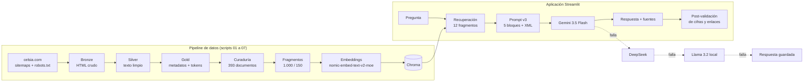
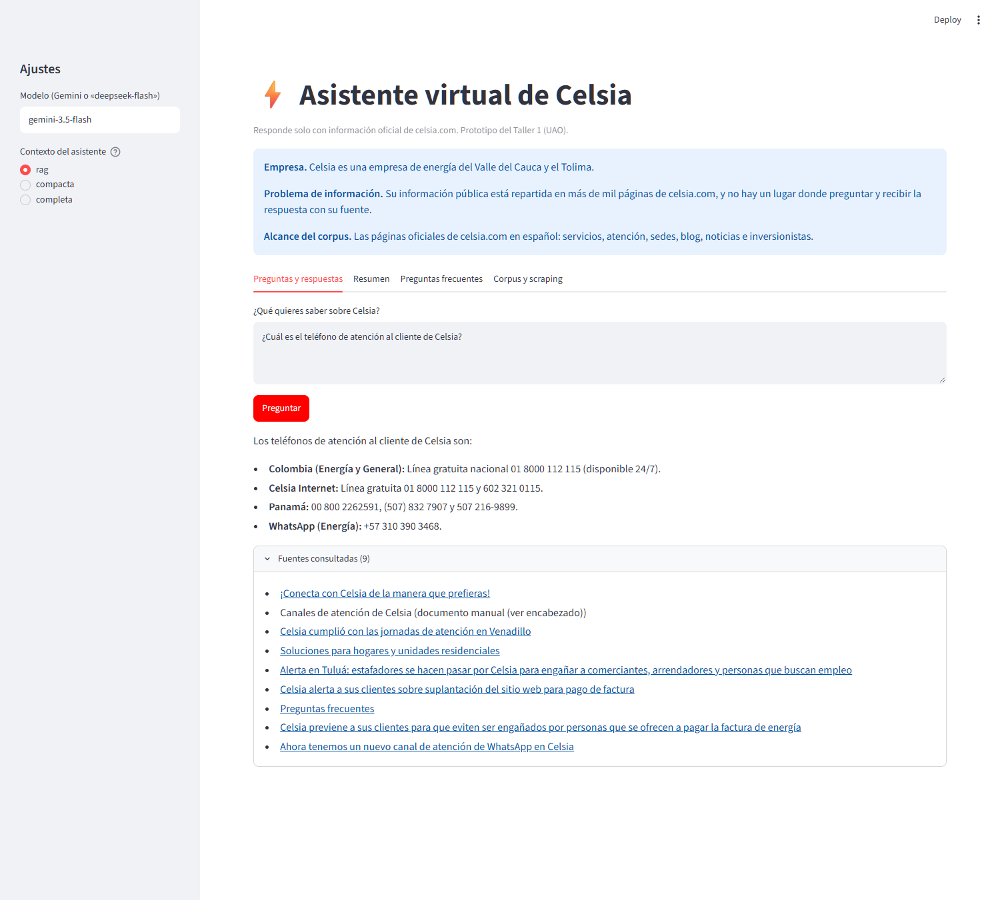
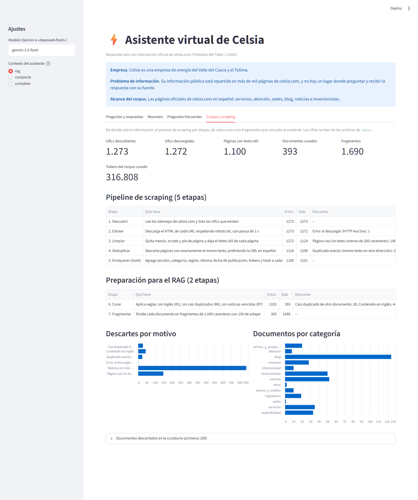

# ⚡ Asistente virtual de Celsia

[](https://github.com/mariastefuentes/taaml-celsia-asistente/actions/workflows/ci.yml)


[](LICENSE)

Base de conocimiento y asistente de preguntas y respuestas (Q&A, resumen y FAQ) sobre **Celsia**, empresa de energía del Valle del Cauca y el Tolima. Responde **solo con información oficial de celsia.com** y dice «no sé» cuando la fuente no lo trae. Taller 1 del curso *Técnicas avanzadas de IA aplicadas en modelos de lenguaje* (Maestría en IA y Ciencias de Datos, UAO, 2026-2S).

## Problema y solución

**Problema de información.** La información pública de Celsia está repartida en más de mil páginas de celsia.com, y no hay un lugar donde preguntar y recibir la respuesta con su fuente.

**Solución.** Un sistema de **RAG** (generación aumentada por recuperación): se descarga y limpia el sitio, se divide en fragmentos, y para cada pregunta se buscan los 12 más parecidos por significado (embeddings en una base vectorial Chroma). Solo esos fragmentos van al prompt, con instrucciones que obligan a responder con ellos y a citar la fuente.

| Resultado medido | Valor |
|---|---|
| Corpus curado | 393 documentos, 1.690 fragmentos, ~316.800 tokens |
| Recuperación (la respuesta está entre los 12 fragmentos) | 89 % con embeddings (54 % por palabras, 74 % híbrido). El 89 % se midió con las mismas preguntas que motivaron el diccionario de sinónimos: con preguntas nuevas sería menor |
| Preguntas de prueba | 59 (35 con respuesta y 24 que no deben responderse), 4 de inyección |
| Respuestas correctas | Según el juez automático: 31 de 35 con respuesta y 21 de 24 negativas bien resueltas. Con la revisión asistida: 29 de 35 y 19 de 24. Los veredictos de la revisión los propuso el asistente de código y los ratificó María Stella Fuentes |
| Costo frente a pegar toda la base en el prompt | unas 80 veces menor por pregunta |

El detalle y las limitaciones están en el [informe](docs/3%20-%20Informe/informe_taller1.md).

## Arquitectura



La app tiene cuatro pestañas: **Preguntas y respuestas** (con fuentes), **Resumen**, **Preguntas frecuentes** y **Corpus y scraping** (etapas del pipeline y métricas).

## Capturas

| Preguntas y respuestas con fuentes | Corpus y scraping |
|---|---|
|  |  |

## Instalación

Requisitos: [uv](https://docs.astral.sh/uv/) (regla del curso: solo `uv`, sin `pip` ni `requirements.txt`), Python 3.12 y [Ollama](https://ollama.com/) con el modelo `nomic-embed-text-v2-moe` para los embeddings de las preguntas. Opcional: `llama3.2:3b`, el respaldo local que responde cuando no hay `GOOGLE_API_KEY` o se agota la cuota.

```bash
git clone https://github.com/mariastefuentes/taaml-celsia-asistente.git
cd taaml-celsia-asistente
make setup               # uv sync + .env + modelos de Ollama (nomic y llama3.2:3b)
# o paso a paso:
# uv sync
# cp .env.example .env   # completa GOOGLE_API_KEY (Gemini); sin ella responde el modelo local
# ollama pull nomic-embed-text-v2-moe
# ollama pull llama3.2:3b
make indice              # construye el índice de vectores con Ollama (el repositorio no versiona el .npz ni Chroma)
```

**En Windows:** clona en una ruta corta y fuera de OneDrive (por ejemplo `C:\taaml`) y activa las rutas largas con `git config --global core.longpaths true`; si `uv sync` falla por enlaces duros, ejecuta antes `$env:UV_LINK_MODE="copy"`. Sin esto, Windows corta las rutas de más de 260 caracteres y el clon queda incompleto.

## Ver el scraper en vivo

```bash
make scraping-demo      # descarga 5 páginas de celsia.com en data/_demo_scraping/ (respeta robots.txt, pausa de 1 s; no toca data/1_bronze)
```

Para reconstruir la base **desde cero** (descargar todo el sitio): `scripts/01_scrape_celsia.py` y `scripts/02_obtener_sedes.py`, y luego `make datos` y `make indice` (tabla de pasos más abajo).

## Uso

```bash
make setup                                # uv sync + .env + modelo de embeddings (una sola vez por equipo)
make modulo1                              # la app del Módulo 1: solo el corpus y las etapas del scraping
uv run streamlit run app.py               # la aplicación completa (Q&A, Resumen, FAQ y Corpus)
make test                                 # pruebas de componentes, sin Gemini ni Ollama (el CI las corre en cada PR)
make lint                                 # ruff y lock vigente
uv run python scripts/16_ensayo_demo.py   # revisa que la demo esté lista, sin gastar cuota
```

`make` muestra el menú de atajos (`setup`, `modulo1`, `app`, `datos`, `indice`, `scraping-demo`, `recuperacion`, `ensayo`, `evaluar`, `pdf`).

**Demo del Módulo 1.** `app_modulo1.py` es la versión que se sustenta en la sesión 8: muestra solo las métricas del corpus y las etapas del scraping (descubrir → extraer → limpiar → deduplicar → enriquecer → curar → fragmentar), sin Q&A, Resumen ni FAQ. La app completa queda en `app.py` (`make app`). El scraping en vivo se ejecuta con `make scraping-demo`.

<details>
<summary><b>Referencia detallada: cómo se construye la base, pruebas y opciones</b></summary>

### Cómo se construye la base de conocimiento
Los datos pasan por tres capas (patrón Medallion): cada script hace una sola etapa, en este orden.

| Paso | Comando | Resultado |
|---|---|---|
| 1. Descargar (Bronze) | `uv run python scripts/01_scrape_celsia.py --sections page,blog-celsia,noticias` y `uv run python scripts/02_obtener_sedes.py` | HTML crudo y sedes en `data/1_bronze/` |
| 2. Limpiar (Silver) | `uv run python scripts/03_construir_silver.py` | texto útil, sin duplicados, en `data/2_silver/` |
| 3. Enriquecer (Gold) | `uv run python scripts/04_construir_gold.py` | texto con metadatos en `data/3_gold/` |
| 4. Curar | `uv run python scripts/05_curar_base.py` | `data/4_curaduria/base_conocimiento.txt` y el registro de decisiones |
| 4b. Fragmentar (chunking) | `uv run python scripts/06_construir_chunks.py` | `data/4_curaduria/chunks.jsonl`: 1.690 fragmentos con sus metadatos |
| 4c. Indexar (embeddings) | `uv run python scripts/07_construir_indice.py` (necesita Ollama y `nomic-embed-text-v2-moe`) | `data/4_curaduria/indice_embeddings.npz` (un vector por fragmento, caché) y la base vectorial Chroma `data/4_curaduria/chroma` (no se sube a Git; sin ella la app usa el `.npz`) |
| 5. Verificar alcance | `uv run python scripts/08_inventario_intenciones.py` | cobertura de las intenciones del cliente |
| 6. Validar la prueba | `uv run python scripts/09_conjunto_de_prueba.py` | comprueba los criterios del conjunto de prueba (59 preguntas) |
| 7. Evaluar un modelo | `uv run python scripts/11_evaluar_modelo.py --modelo gemini:gemini-3.5-flash` | respuestas y calificaciones en `docs/2 - Conjunto de prueba/resultados/` |

Archivos binarios: el repositorio no versiona PDF ni la matriz de vectores (`indice_embeddings.npz`). Los PDF se generan con `make pdf` y el índice con `make indice` (necesita Ollama con `nomic-embed-text-v2-moe`); sin índice la búsqueda cae a palabras.

Reglas del scraper: respeta `robots.txt` (los PDF de celsia.com están bloqueados), espera 1 segundo entre peticiones y es reanudable.
**`data/1_bronze/` (HTML crudo, ~250 MB) no se sube a GitHub** (está en `.gitignore`): se regenera con el comando del paso 1. Lo que se entrega como base de conocimiento es Silver, Gold y `data/4_curaduria/`.
Los datos que el sitio muestra solo como enlaces (WhatsApp, PQR, pagos) están escritos a mano, con su fuente, en `data/0_manual/`.

### Pruebas y atajos
`make test` corre las pruebas automáticas de componentes (sin Gemini ni Ollama) y `make` muestra los demás atajos (`datos`, `app`, `evaluar`, `pdf`). `uv run python scripts/12_probar_inyeccion_indirecta.py` prueba órdenes escondidas en los documentos (4 llamadas a Gemini).

### Opciones que se activan a propósito
- **Post-validación.** La app avisa si una cifra, un correo o un enlace de la respuesta no aparece en las fuentes consultadas (`src/taaml/validacion.py`); `scripts/14_validar_respuestas.py` lo mide sobre las respuestas guardadas, sin modelo.
- **Continuidad de la demo.** Si el modelo elegido falla por cuota o conexión, la app prueba `deepseek-flash` (si hay clave) y luego `ollama:llama3.2` (local), y si ninguno responde muestra la respuesta ya evaluada (v3) de esa pregunta, marcada como guardada (`src/taaml/respaldo.py`). `uv run python scripts/16_ensayo_demo.py` revisa que todo esté listo sin gastar; con `--llamar` hace una llamada corta por proveedor.
- **Agente con herramienta.** `uv run python scripts/15_probar_agente.py` pregunta a un agente `create_agent` con Llama 3.2 en Ollama (sin costo; tarda minutos en CPU).
- **Extracción a JSONL.** `uv run python scripts/13_extraer_contactos.py` (3 llamadas a Gemini) escribe `data/5_extraccion/contactos.jsonl`.
- **Trazabilidad (LangSmith).** Si el `.env` tiene `LANGCHAIN_API_KEY`, la app y las tareas registran cada ejecución (pregunta, fragmentos, prompt, respuesta, tokens y tiempo) en el proyecto `taaml-celsia` de smith.langchain.com. Sin la clave no se envía nada. La evaluación (`11_evaluar_modelo.py`) llama a la API directamente y no se traza.
- **Reordenamiento de fragmentos.** `responder_con_fuentes(..., reordenar=True)` o `--reordenar` en los scripts 10 y 11: recupera 30 candidatos y `gemini-3.5-flash-lite` elige los 12 mejores. Cuesta una llamada más por pregunta y está apagado por defecto.
- **DeepSeek en lugar de Gemini.** Con `DEEPSEEK_API_KEY` en el `.env`, escribir `deepseek-flash` (o `deepseek-v4-pro`) en el campo «Modelo» de la app, o pasar `modelo="deepseek-flash"` a las tareas, usa DeepSeek con el razonamiento apagado; el reordenador también cambia a `deepseek-flash`. En la evaluación: `--modelo deepseek:deepseek-flash --juez deepseek:deepseek-v4-pro`. DeepSeek respeta `temperature 0.0`, pero deja `top_p` fijo en 1,0.

</details>

## Estructura
Equivalencias de datos: `data/1_bronze/` es el crudo (raw), `data/2_silver/` el procesado (processed) y `data/3_gold/` el corpus con metadatos (gold). Cada documento de Gold lleva `url`, `title`, `categoria` (la sección del sitio), `fecha_extraccion` (captura), `fecha_publicacion`, `section` (el sitemap de origen) y `hash`; Silver conserva `url`, `title`, `section`, `fecha_publicacion` y `hash`.

```
docs/        análisis de la empresa, conjunto de prueba, informe y capturas
scripts/     01 a 17: etapas del pipeline y pruebas en el orden en que se usan; utilidades/: herramientas sueltas
data/        0_manual/ 1_bronze/ 2_silver/ 3_gold/ 4_curaduria/ 5_extraccion/
src/taaml/   código del asistente (base.py, recuperacion.py, sinonimos.py, reordenar.py, validacion.py, respaldo.py, agente.py, prompts.py, tareas.py)
prompts/     prompts versionados (asistente v3 vigente, v4 y v5 descartados; resumen y FAQ v2; agente y extracción v1)
tests/       pruebas automáticas de componentes (make test)
specs/      especificaciones (qué, cómo y tareas) de cada cambio; 001 a 009: asistente, validación y agente, continuidad de la demo, base vectorial, evidencia de Resumen y FAQ, pestaña Corpus, prueba del scraper y etapa Descubrir
.specify/   memoria del proyecto: memory/constitution.md (verdad central)
.opencode/  skills propias para agentes (skills/corpus-medallion), escaneadas con SkillSpector
.github/    plantilla de Pull Request y CI
app.py       aplicación Streamlit completa (preguntas y respuestas, resumen y FAQ)
app_modulo1.py  aplicación del Módulo 1 (solo corpus y scraping)
```

## Licencia

Licencia MIT ([LICENSE](LICENSE)), © 2026 María Stella Fuentes, Juan José Mosquera, Nicolás Bolaños y Jensen Fabián Tamayo. El contenido de celsia.com pertenece a Celsia y se usa aquí con fines académicos, respetando su `robots.txt`.

## Créditos

**Grupo 4, Celsia.** Juan José Mosquera, Nicolás Bolaños, Jensen Fabián Tamayo y María Stella Fuentes. Maestría en IA y Ciencias de Datos, Universidad Autónoma de Occidente, curso *Técnicas avanzadas de IA aplicadas en modelos de lenguaje*, 2026-2S.

Herramientas: LangChain, Streamlit, Chroma, Ollama, Gemini y DeepSeek. El código se escribió con ayuda de Claude Code; la declaración completa de uso de IA está en el informe.
