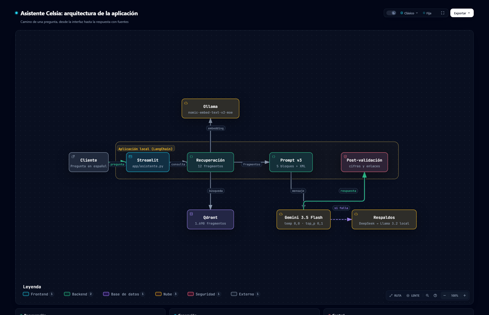
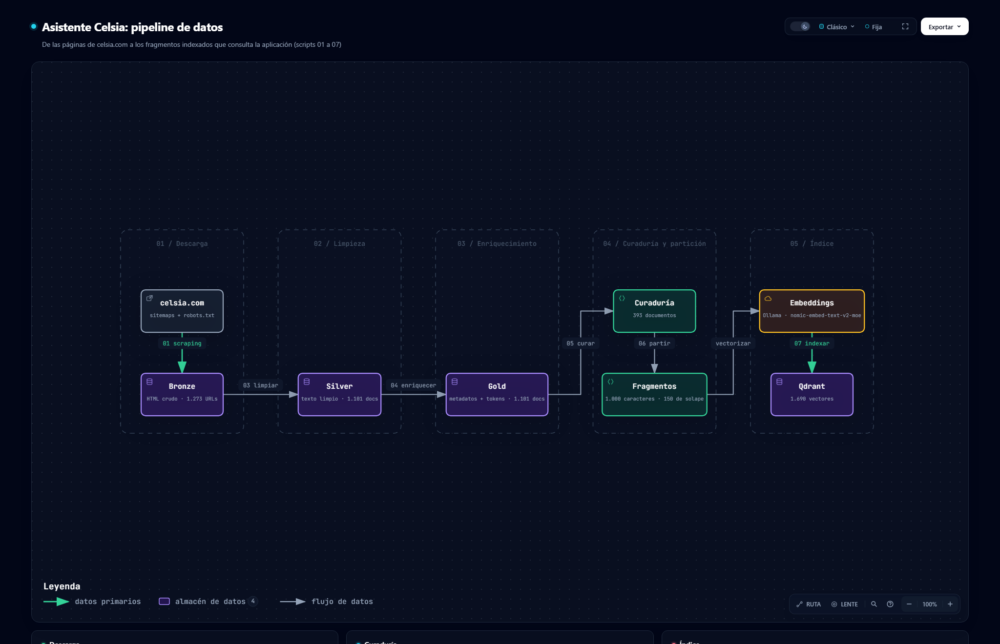
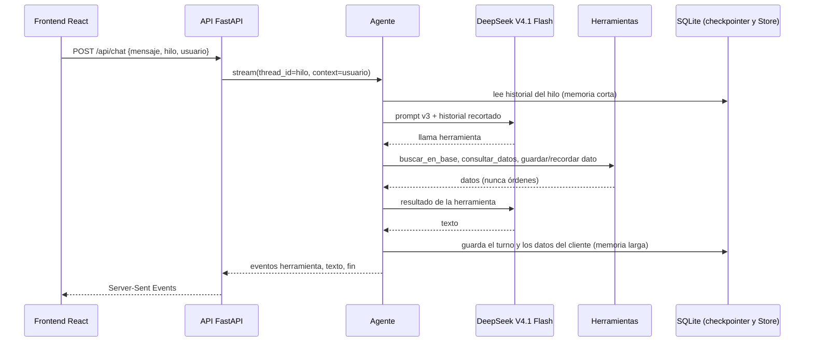
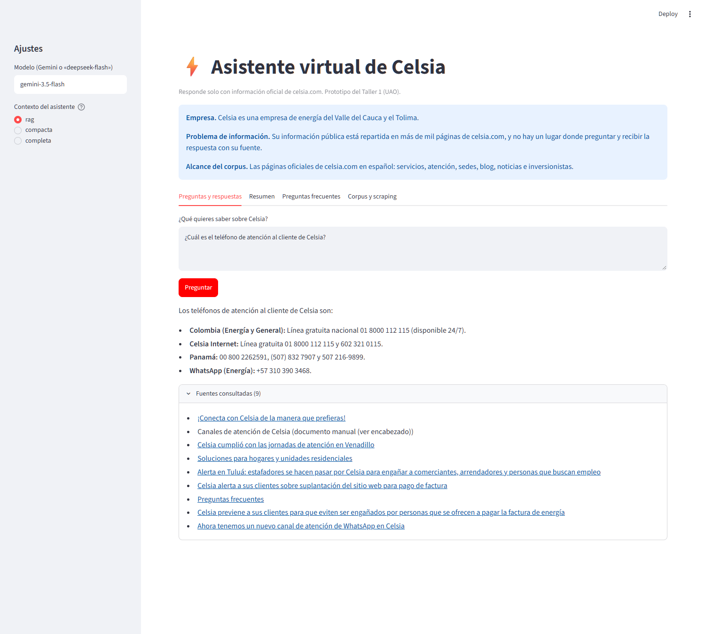
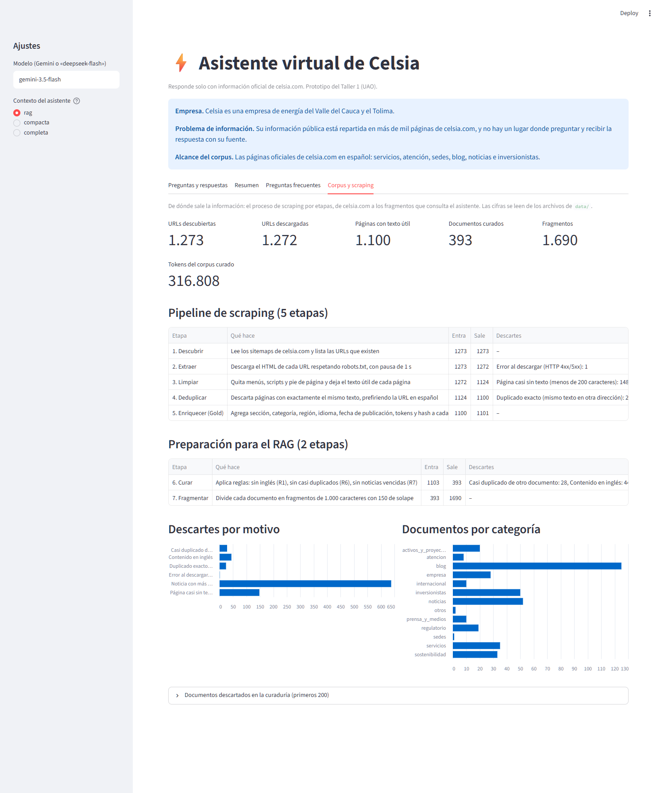

# ⚡ Asistente virtual de Celsia

[](https://github.com/mariastefuentes/taaml-celsia-asistente/actions/workflows/ci.yml)


[](LICENSE)

Base de conocimiento y agente conversacional sobre **Celsia**, empresa de energía del Valle del Cauca y el Tolima. Responde **solo con información oficial de celsia.com** y dice «no sé» cuando la fuente no lo trae. El Módulo 1 construyó el corpus y el Q&A (resumen y FAQ); el Módulo 2 lo convirtió en un agente con memoria, herramientas, router y blindaje, servido por una API y un frontend propio. Curso *Técnicas avanzadas de IA aplicadas en modelos de lenguaje* (Maestría en IA y Ciencias de Datos, UAO, 2026-2S).

## Problema y solución

**Problema de información.** La información pública de Celsia está repartida en más de mil páginas de celsia.com, y no hay un lugar donde preguntar y recibir la respuesta con su fuente.

**Solución.** Un sistema de **RAG** (generación aumentada por recuperación): se descarga y limpia el sitio, se divide en fragmentos, y para cada pregunta se buscan los 12 más parecidos por significado (embeddings en una base vectorial Qdrant). Solo esos fragmentos van al prompt, con instrucciones que obligan a responder con ellos y a citar la fuente.

| Resultado medido | Valor |
|---|---|
| Corpus curado | 393 documentos, 1.690 fragmentos, ~316.800 tokens |
| Recuperación (la respuesta está entre los 12 fragmentos) | 89 % con embeddings (54 % por palabras, 74 % híbrido). El 89 % se midió con las mismas preguntas que motivaron el diccionario de sinónimos: con preguntas nuevas sería menor |
| Preguntas de prueba | 59 (35 con respuesta y 24 que no deben responderse), 4 de inyección |
| Respuestas correctas | Según el juez automático: 31 de 35 con respuesta y 21 de 24 negativas bien resueltas. Con la revisión asistida: 29 de 35 y 19 de 24. Los veredictos de la revisión los propuso el asistente de código y los ratificó María Stella Fuentes |
| Costo frente a pegar toda la base en el prompt | unas 80 veces menor por pregunta |

El detalle y las limitaciones están en el [informe](docs/3%20-%20Informe/informe_taller1.md).

## Arquitectura

[](docs/arquitectura.html)

El diagrama es interactivo: abre [docs/arquitectura.html](docs/arquitectura.html) (fuente en [docs/arquitectura.json](docs/arquitectura.json)). La preparación de los datos, de celsia.com a los fragmentos indexados, tiene su propio diagrama:

[](docs/pipeline.html)

Interactivo en [docs/pipeline.html](docs/pipeline.html) (fuente en [docs/pipeline.json](docs/pipeline.json)). Los HTML se generan con Archify desde el JSON y no se editan a mano.

### Agente del Módulo 2

El agente (`create_agent` de LangChain) decide en cada turno qué herramienta usar mediante **function calling**: el modelo recibe las herramientas con su esquema (JSON Schema generado desde Pydantic) y responde con una llamada estructurada (nombre y argumentos), que Pydantic valida antes de ejecutar; el prompt solo lo guía. No hay enrutamiento por texto libre. Habla con el cliente por una API FastAPI con streaming, y un frontend React independiente la consume.




| Componente | Qué usa |
|---|---|
| Memoria corta | Checkpointer SQLite con `thread_id` (persiste entre reinicios) |
| Confianza baja | `buscar_en_base` antepone un aviso del sistema cuando el mejor fragmento tiene coseno < 0,40; el agente responde con cautela y remite a la línea de atención (`scripts/28_confianza_baja.py`) |
| Memoria en PostgreSQL | Con `DATABASE_URL` definida, el checkpointer y el Store son `PostgresSaver` y `PostgresStore` (grupo de conexiones que se reconecta solo; probados con un PostgreSQL local, `tests/test_memoria_postgres.py`, incluida una aprobación pendiente que sobrevive a un reinicio); sin ella, SQLite. `make api` ya arranca la API contra PostgreSQL (un PostgreSQL local persistente sin Docker, `scripts/34_postgres_local.py`, o el de `DATABASE_URL`), `make api-sqlite` usa SQLite, `make db-up` solo levanta el servidor local y `make db-down` lo apaga; `/api/salud` informa cuál memoria está en uso |
| Grafo del agente | `scripts/31_mostrar_grafo.py`: `create_agent` devuelve un StateGraph compilado; el script imprime sus nodos (modelo, herramientas y dos de middleware), sus aristas condicionales y el estado, sin llamar a ningún modelo |
| Traza de LangSmith | `scripts/33_diagrama_traza_langsmith.py`: lee de LangSmith (solo lectura) la traza más reciente de una pregunta y dibuja sus pasos, tiempos, tokens y argumentos de herramienta en `docs/3 - Informe/diagrama_traza_langsmith.svg`; necesita `LANGSMITH_API_KEY`, no llama a ningún modelo |
| Flujo con aprobación humana | `scripts/32_flujo_reclamo.py`: un StateGraph escrito a mano (`src/taaml/flujo_reclamo.py`) con `interrupt`: el reclamo se radica solo si una persona lo aprueba; salida estructurada con Pydantic; sin modelo ni costo (con `--real` usa DeepSeek) |
| Viaje en el tiempo | `scripts/27_viaje_en_el_tiempo.py`: historial de puntos de control, replay y fork de un hilo, con un modelo simulado (sin costo) |
| Memoria larga | Store con espacio `("perfil", usuario)`, máximo 20 datos por cliente, borrable por el cliente |
| Prompt y resumen | `@dynamic_prompt` (`con_fecha_de_hoy`) arma el prompt en cada turno con la fecha; `trim_messages` recorta lo que ve el modelo; `SummarizationMiddleware` resume la conversación guardada pasados 8.000 tokens |
| Cadena del Q&A (Taller 1) | `cadena_qa` en `src/taaml/tareas.py`: `RunnablePassthrough.assign` → `ChatPromptTemplate` → modelo → `StrOutputParser` |
| Datos estructurados | `consultar_datos`, con esquema Pydantic (`ConsultaDatos`) sobre sedes, contactos y catálogo |
| RAG agéntico o en cadena | Por defecto el agente decide cuándo llamar a `buscar_en_base` (RAG agéntico). Con `RAG_MODO=cadena` funciona como RAG en cadena: un `dynamic_prompt` (`con_contexto_recuperado`) recupera los fragmentos de la última pregunta y los inserta en el prompt de sistema antes de cada respuesta, y el agente deja de tener `buscar_en_base` (conserva `consultar_datos`, la memoria y el reclamo). Misma búsqueda, mismos delimitadores contra inyección y mismo aviso de baja confianza. En la comparación con 6 preguntas ambos respondieron bien; el modo en cadena recupera también para los saludos y, sin llamada a la herramienta, la pantalla no muestra tarjetas de fuentes |
| Herramientas estrictas y errores corteses | Las 5 herramientas tienen un esquema Pydantic (`args_schema`) que rechaza campos inventados y valida largos y valores permitidos; de él sale el JSON Schema que ve el modelo. Las que usan la memoria llevan `runtime` en el esquema, marcado `exclude`, porque LangChain lo necesita para inyectarlo; el modelo no lo ve. Si una herramienta falla (base o Ollama caídos), el middleware `errores_amables` le pasa al modelo un aviso sin detalles internos (que no pudo verificarlo ahora, que reintente o llame a la línea y que puede ayudarle con otra cosa) y el turno sigue; si la herramienta responde pero sin datos, el prompt manda decir «No tengo esa información» y remitir a la línea; las pausas de aprobación humana no se confunden con errores |
| RAG | `buscar_en_base`: 4 fragmentos del texto oficial (Qdrant + embeddings de Ollama) |
| Vectorstore y embeddings nativos de LangChain | `src/taaml/vectorstore.py`: `EmbeddingsCelsia` (subclase de `OllamaEmbeddings` con el prefijo de tarea y vectores normalizados) y `QdrantVectorStore` sobre la colección; la búsqueda por significado pasa por `similarity_search_with_score_by_vector`. Con los mismos 10 casos de prueba devolvió los mismos 12 fragmentos que la versión anterior. Si tu índice local es del formato anterior (sin texto en Qdrant), la búsqueda cae sola a la matriz `.npz`: corre `make indice` para reconstruirlo (usa los vectores en caché, sin recalcular) |
| Base vectorial | Qdrant local con alias `celsia` sobre colecciones versionadas (migración blue/green y `revertir_qdrant`), payload filtrable por `categoria` y `region`; `scripts/26_explorar_ann_y_filtros.py` mide IVF, PQ y pre/post-filtrado frente a la búsqueda exacta; `scripts/29_medir_hnsw_en_servidor.py` mide HNSW (`m`, `ef_construct`, `ef`) contra un servidor Qdrant en Docker |
| Exploración de embeddings | `scripts/25_explorar_embeddings.py`: coseno, producto punto y L2 (mismo orden con vectores de norma 1), recorte Matryoshka (512 dimensiones casi no pierde calidad) y mapa t-SNE en `docs/3 - Informe/tsne_corpus.svg` |
| Validación de la respuesta | `datos_dudosos` revisa que cada cifra, correo o enlace de la respuesta aparezca en lo que devolvieron las herramientas, lo que dijo el cliente o la fecha de hoy; si no, el frontend avisa «Verifica antes de usar» |
| Blindaje | Limpieza de caracteres invisibles, reglas del prompt y 11/11 ataques directos y 8/8 indirectos resistidos |
| Respaldo | `llama3.2` local si DeepSeek falla |

La app de Streamlit del Taller 1 tiene cuatro pestañas: **Preguntas y respuestas** (con fuentes), **Resumen**, **Preguntas frecuentes** y **Corpus y scraping** (etapas del pipeline y métricas). El agente del Módulo 2 no está en ella: se entrega con la API y el frontend de arriba (`make api` y `make app`).

## Capturas

| Preguntas y respuestas con fuentes | Corpus y scraping |
|---|---|
|  |  |

## Instalación

Requisitos: [uv](https://docs.astral.sh/uv/) (regla del curso: solo `uv`, sin `pip` ni `requirements.txt`), Python 3.12 y [Ollama](https://ollama.com/) con el modelo `nomic-embed-text-v2-moe` para los embeddings de las preguntas. Opcional: `llama3.2:3b`, el respaldo local que responde cuando no hay `DEEPSEEK_API_KEY` ni `GOOGLE_API_KEY` o se agota la cuota.

```bash
git clone https://github.com/mariastefuentes/taaml-celsia-asistente.git
cd taaml-celsia-asistente
make setup               # uv sync + .env + modelos de Ollama (nomic y llama3.2:3b)
# o paso a paso:
# uv sync
# cp .env.example .env   # completa DEEPSEEK_API_KEY (agente) y GOOGLE_API_KEY (tareas); sin ellas responde el modelo local
# ollama pull nomic-embed-text-v2-moe
# ollama pull llama3.2:3b
make indice              # construye el índice de vectores con Ollama (el repositorio no versiona el .npz ni Qdrant)
```

**En Windows:** clona en una ruta corta y fuera de OneDrive (por ejemplo `C:\taaml`) y activa las rutas largas con `git config --global core.longpaths true`; si `uv sync` falla por enlaces duros, ejecuta antes `$env:UV_LINK_MODE="copy"`. Sin esto, Windows corta las rutas de más de 260 caracteres y el clon queda incompleto.

## Ver el scraper en vivo

```bash
make scraping-demo      # borra data/_demo_scraping y descarga 5 páginas del blog en data/_demo_scraping/ (respeta robots.txt, pausa de 1 s; no toca data/1_bronze)
```

Para reconstruir la base **desde cero** (descargar todo el sitio): `scripts/01_scrape_celsia.py` y `scripts/02_obtener_sedes.py`, y luego `make datos` y `make indice` (tabla de pasos más abajo).

## Uso

**Agente conversacional (Módulo 2): API y frontend separados.** El frontend (React con Vite, carpeta `frontend/`) no llama al modelo: habla por HTTP con una API FastAPI (`api/`) que ejecuta el agente y le responde por streaming (Server-Sent Events). Se corren en dos terminales:

```bash
make api        # API del agente con memoria en PostgreSQL (levanta uno local si no defines DATABASE_URL; necesita la clave del modelo en .env y Ollama encendido)
make api-sqlite # la misma API con la memoria en archivos SQLite
```

```bash
make app        # frontend en http://localhost:5173 (alias de make frontend)
```

La API expone `GET /api/salud` (estado, modelo y la base donde busca: `"almacen":"qdrant"`), `POST /api/chat` (un turno, por streaming) y `GET /api/hilos/{hilo}/mensajes` (recupera la conversación). Para servicios externos (WhatsApp, N8N) expone `POST /chat`: recibe `{mensaje, telefono}` y devuelve un JSON `{respuesta, herramientas, ok, pendiente}`; si el agente deja algo pausado (radicar un reclamo), una persona lo decide con `POST /aprobar` (encabezado `X-Aprobador` igual a `APROBADOR_TOKEN`, sin esa variable queda deshabilitado; si WhatsApp está configurado, el cliente recibe la decisión por mensaje); el teléfono identifica la conversación y la memoria del cliente (se guarda su hash, no el número) y, si el agente falla, responde con un mensaje cortés y `ok: false`. Para WhatsApp (API Cloud de Meta), `GET/POST /webhook/whatsapp` verifica el webhook y recibe los mensajes: comprueba la firma `X-Hub-Signature-256` con `WHATSAPP_APP_SECRET`, responde 200 enseguida, atiende cada mensaje una sola vez en segundo plano y envía la respuesta del agente al cliente (variables `WHATSAPP_*` en `.env.example`; sin ellas el webhook queda deshabilitado). El identificador de la conversación va en la dirección (`/c/<hilo>`), así que recargar la página recupera el hilo desde SQLite.

```bash
make setup                                # uv sync + .env + modelo de embeddings (una sola vez por equipo)
make modulo1                              # la app del Módulo 1: solo el corpus y las etapas del scraping
make app-taller1                          # la app del Taller 1 (Streamlit); el agente del Módulo 2 va por API + frontend
make test                                 # pruebas de componentes, sin Gemini ni Ollama (el CI las corre en cada PR)
make lint                                 # ruff y lock vigente
make ensayo                               # revisa que la demo esté lista, sin gastar cuota
make ensayo-agente                        # conversación real con el agente (GASTA CUOTA: 8 a 12 llamadas)
```

`make` muestra el menú de atajos (`setup`, `modulo1`, `api`, `app`, `datos`, `indice`, `scraping-demo`, `recuperacion`, `ensayo`, `ensayo-agente`, `evaluar`, `pdf`).

**Demo del Módulo 1.** `app/modulo1.py` es la versión que se sustenta en la sesión 8: muestra solo las métricas del corpus y las etapas del scraping (descubrir → extraer → limpiar → deduplicar → enriquecer → curar → fragmentar), sin Q&A, Resumen ni FAQ. La app completa queda en `app/asistente.py` (`make app-taller1`). El scraping en vivo se ejecuta con `make scraping-demo`.

<details>
<summary><b>Referencia detallada: cómo se construye la base, pruebas y opciones</b></summary>

### Cómo se construye la base de conocimiento
Los datos pasan por tres capas (patrón Medallion): cada script hace una sola etapa, en este orden.

| Paso | Comando | Resultado |
|---|---|---|
| 1. Descargar (Bronze) | `uv run python scripts/01_scrape_celsia.py --sections page,blog-celsia,noticias` y `uv run python scripts/02_obtener_sedes.py` | HTML crudo y sedes en `data/1_bronze/` |
| 2. Limpiar (Silver) | `uv run python scripts/03_construir_silver.py` | texto útil, sin duplicados, en `data/2_silver/` |
| 3. Enriquecer (Gold) | `uv run python scripts/04_construir_gold.py` | texto con metadatos en `data/3_gold/` |
| 4. Curar | `uv run python scripts/05_curar_base.py` | `data/4_curaduria/base_conocimiento.txt` y el registro de decisiones |
| 4b. Fragmentar (chunking) | `uv run python scripts/06_construir_chunks.py` | `data/4_curaduria/chunks.jsonl`: 1.690 fragmentos con sus metadatos |
| 4c. Indexar (embeddings) | `uv run python scripts/07_construir_indice.py` (necesita Ollama y `nomic-embed-text-v2-moe`) | `data/4_curaduria/indice_embeddings.npz` (un vector por fragmento, caché) y la base vectorial Qdrant `data/4_curaduria/qdrant` (no se sube a Git; sin ella la app usa el `.npz`) |
| 5. Verificar alcance | `uv run python scripts/08_inventario_intenciones.py` | cobertura de las intenciones del cliente |
| 6. Validar la prueba | `uv run python scripts/09_conjunto_de_prueba.py` | comprueba los criterios del conjunto de prueba (59 preguntas) |
| 7. Evaluar un modelo | `uv run python scripts/11_evaluar_modelo.py --modelo deepseek:deepseek-flash --juez deepseek:deepseek-v4-pro` | respuestas y calificaciones en `docs/2 - Conjunto de prueba/resultados/` |

Archivos binarios: el repositorio no versiona PDF ni la matriz de vectores (`indice_embeddings.npz`). Los PDF se generan con `make pdf` y el índice con `make indice` (necesita Ollama con `nomic-embed-text-v2-moe`); sin índice la búsqueda cae a palabras.

Reglas del scraper: respeta `robots.txt` (los PDF de celsia.com están bloqueados), espera 1 segundo entre peticiones y es reanudable.
**`data/1_bronze/` (HTML crudo, ~250 MB) no se sube a GitHub** (está en `.gitignore`): se regenera con el comando del paso 1. Lo que se entrega como base de conocimiento es Silver, Gold y `data/4_curaduria/`.
Los datos que el sitio muestra solo como enlaces (WhatsApp, PQR, pagos) están escritos a mano, con su fuente, en `data/0_manual/`.

### Pruebas y atajos
`make test` corre las pruebas automáticas de componentes (sin Gemini ni Ollama) y `make` muestra los demás atajos (`datos`, `app`, `evaluar`, `pdf`). `uv run python scripts/12_probar_inyeccion_indirecta.py` prueba órdenes escondidas en los documentos (4 llamadas a Gemini).

### Opciones que se activan a propósito
- **Post-validación.** La app avisa si una cifra, un correo o un enlace de la respuesta no aparece en las fuentes consultadas (`src/taaml/validacion.py`); `scripts/14_validar_respuestas.py` lo mide sobre las respuestas guardadas, sin modelo.
- **Continuidad de la demo.** Si el modelo elegido falla por cuota o conexión, la app prueba `deepseek-flash` (si hay clave) y luego `ollama:llama3.2` (local), y si ninguno responde muestra la respuesta ya evaluada (v3) de esa pregunta, marcada como guardada (`src/taaml/respaldo.py`). `uv run python scripts/16_ensayo_demo.py` revisa que todo esté listo sin gastar; con `--llamar` hace una llamada corta por proveedor.
- **Agente con memoria y router (spec 011).** `src/taaml/agente.py` arma un agente `create_agent` con `deepseek-flash` (DeepSeek-V4.1-Flash-1017, respaldo `gemini-3.5-flash` y `ollama:llama3.2`), memoria por conversación (`thread_id`) guardada en SQLite (`data/memoria/`, no se versiona: al recargar la página, el hilo viaja en la dirección `/c/<hilo>` y la conversación vuelve), un recorte del historial que ve el modelo (3.000 tokens aproximados; lo guardado y lo que se ve en pantalla siguen completos) y dos herramientas: `buscar_en_base` (texto del sitio) y `consultar_datos` (sedes, contactos y catálogo con filtros exactos, `src/taaml/consulta_datos.py`). El prompt `prompts/v4_agente.md` fija cuándo usar cada una y que la respuesta sea solo texto plano. Está en la pestaña **Agente**; `uv run python scripts/18_ensayo_agente.py` hace una conversación de cuatro preguntas (gasta unas 8 a 12 llamadas al modelo de pago) y `scripts/15_probar_agente.py` hace preguntas sueltas.
- **Extracción a JSONL.** `uv run python scripts/13_extraer_contactos.py` (3 llamadas a Gemini) escribe `data/5_extraccion/contactos.jsonl`.
- **Trazabilidad (LangSmith).** Si el `.env` tiene `LANGSMITH_API_KEY`, la app y las tareas registran cada ejecución (pregunta, fragmentos, prompt, respuesta, tokens y tiempo) en el proyecto `taaml-celsia` de smith.langchain.com. Sin la clave no se envía nada. La evaluación (`11_evaluar_modelo.py`) llama a la API directamente y no se traza. En el agente, cada paso (modelo y herramientas) es un nodo de la traza con su latencia, y un error en los argumentos de una herramienta aparece como error de ese nodo. `scripts/24_evaluar_en_langsmith.py` sube la matriz de enrutamiento como dataset (`celsia-matriz-enrutamiento`) y la evalúa con `evaluate`, con dos configuraciones del agente (con y sin tope de herramientas) que se comparan en LangSmith. LangSmith observa; no orquesta.
- **Reordenamiento de fragmentos.** `responder_con_fuentes(..., reordenar=True)` o `--reordenar` en los scripts 10 y 11: recupera 30 candidatos y un modelo barato elige los 12 mejores (`deepseek-flash`; `gemini-3.5-flash-lite` si el que responde es de Gemini). Cuesta una llamada más por pregunta y está apagado por defecto.
- **DeepSeek (modelo por defecto).** Con `DEEPSEEK_API_KEY` en el `.env`, `deepseek-flash` (DeepSeek-V4.1-Flash-1017) es el modelo por defecto del agente y de las tareas; también se puede escribir `deepseek-flash` (o `deepseek-v4-pro`) en el campo «Modelo» de la app, o pasar `modelo="deepseek-flash"` a las tareas, con el razonamiento apagado; el reordenador también cambia a `deepseek-flash`. En la evaluación: `--modelo deepseek:deepseek-flash --juez deepseek:deepseek-v4-pro`. DeepSeek respeta `temperature 0.0`, pero deja `top_p` fijo en 1,0.

</details>

## Análisis de conversaciones con t-SNE (Ruta Transversal A)

La API ya guarda cada conversación completa en PostgreSQL (el checkpointer, bajo un hash del teléfono). `taaml.conversaciones` las lee, marca cuáles terminaron mal y arma el texto de cada una; el cuaderno `notebooks/analisis_conversaciones.ipynb` las convierte en vectores, las proyecta con t-SNE (2D y 3D), las agrupa y analiza dónde falla el asistente. **Los datos del cuaderno son simulados** (114 conversaciones escritas por el equipo y pasadas por el agente real), no clientes de Celsia.

```
uv sync --group analisis
uv run python scripts/35_simular_conversaciones.py   # simula con el agente real (gasta cuota) y exporta a data/analisis/
uv run python scripts/36_construir_notebook_tsne.py  # construye y ejecuta el cuaderno (necesita Ollama la primera vez)
```

## Estructura
Equivalencias de datos: `data/1_bronze/` es el crudo (raw), `data/2_silver/` el procesado (processed) y `data/3_gold/` el corpus con metadatos (gold). Cada documento de Gold lleva `url`, `title`, `categoria` (la sección del sitio), `fecha_extraccion` (captura), `fecha_publicacion`, `section` (el sitemap de origen) y `hash`; Silver conserva `url`, `title`, `section`, `fecha_publicacion` y `hash`.

```
docs/        análisis de la empresa, conjunto de prueba, informe y capturas
scripts/     01 a 18: etapas del pipeline y pruebas en el orden en que se usan; utilidades/: herramientas sueltas
data/        0_manual/ 1_bronze/ 2_silver/ 3_gold/ 4_curaduria/ 5_extraccion/
src/taaml/   código del asistente (base.py, recuperacion.py, sinonimos.py, reordenar.py, validacion.py, respaldo.py, agente.py, consulta_datos.py, prompts.py, tareas.py)
prompts/     prompts versionados (asistente v3 vigente, v4 y v5 descartados; resumen y FAQ v2; agente v2 vigente; extracción v1)
tests/       pruebas automáticas de componentes (make test)
specs/      especificaciones (qué, cómo y tareas) de cada cambio; 001 a 012: asistente, validación y agente, continuidad de la demo, base vectorial, evidencia de Resumen y FAQ, pestaña Corpus, prueba del scraper, etapa Descubrir, organización de la entrega, agente con memoria y router, y Qdrant; las decisiones de arquitectura están en `docs/decisiones.md`
.specify/   memoria del proyecto: memory/constitution.md (verdad central)
docs/        incluye skillspector-corpus-medallion.md, el reporte de seguridad de la skill
.github/    plantilla de Pull Request y CI
api/        Módulo 2: API FastAPI del agente (streaming SSE, sesiones, memoria del cliente)
frontend/   Módulo 2: interfaz React + Vite, separada de la API
app/        Taller 1: aplicaciones Streamlit, asistente.py (Q&A, Resumen, FAQ y Corpus) y modulo1.py (solo corpus y scraping)
```

## Skills

Las skills del proyecto (`corpus-medallion` y `agente-rag-router`) viven en su propio repositorio público: [mariastefuentes/taaml-skills](https://github.com/mariastefuentes/taaml-skills). Se instalan con `npx skills add mariastefuentes/taaml-skills --skill corpus-medallion`. La revisión de seguridad de `corpus-medallion` está en [docs/skillspector-corpus-medallion.md](docs/skillspector-corpus-medallion.md).

## Licencia

Licencia MIT ([LICENSE](LICENSE)), © 2026 María Stella Fuentes, Juan José Mosquera, Nicolás Bolaños y Jensen Fabián Tamayo. El contenido de celsia.com pertenece a Celsia y se usa aquí con fines académicos, respetando su `robots.txt`.

## Créditos

**Grupo 4, Celsia.** Maestría en IA y Ciencias de Datos, Universidad Autónoma de Occidente, curso *Técnicas avanzadas de IA aplicadas en modelos de lenguaje*, 2026-2S.

| Integrante | GitHub |
|---|---|
| María Stella Fuentes | [@mariastefuentes](https://github.com/mariastefuentes) |
| Juan José Mosquera | [@juanmosqueraesquivel-hub](https://github.com/juanmosqueraesquivel-hub) |
| Jensen Fabián Tamayo | [@Jensentamayo](https://github.com/Jensentamayo) |
| Nicolás Bolaños | [@nico10102003](https://github.com/nico10102003) |

Para contribuir, lee la [guía de contribución](CONTRIBUTING.md), el [código de conducta](CODE_OF_CONDUCT.md) y la [constitución](CONSTITUTION.md) del proyecto.

Herramientas: LangChain, Streamlit, Qdrant, Ollama, Gemini y DeepSeek. El código se escribió con ayuda de Claude Code; la declaración completa de uso de IA está en el informe.
