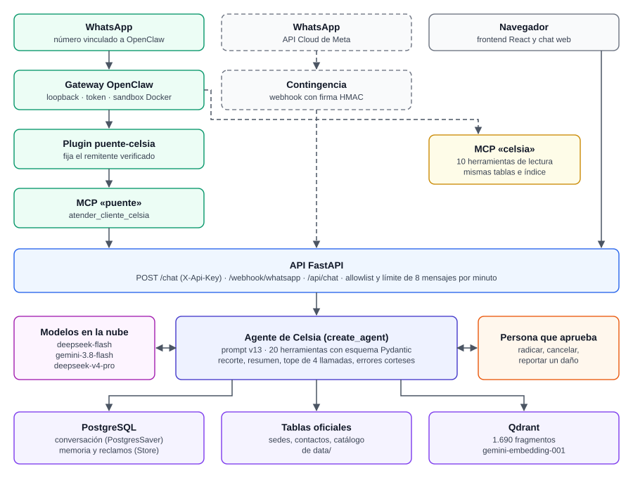
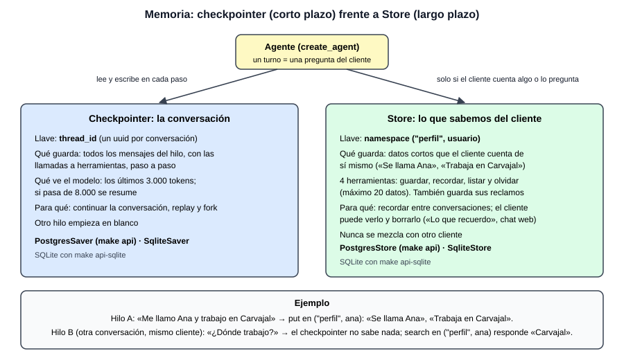
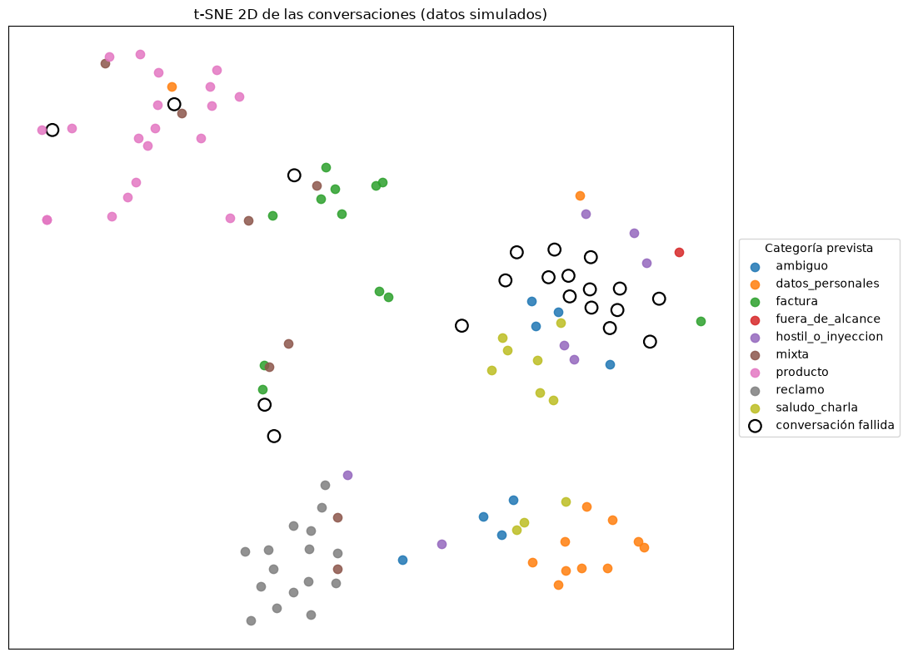
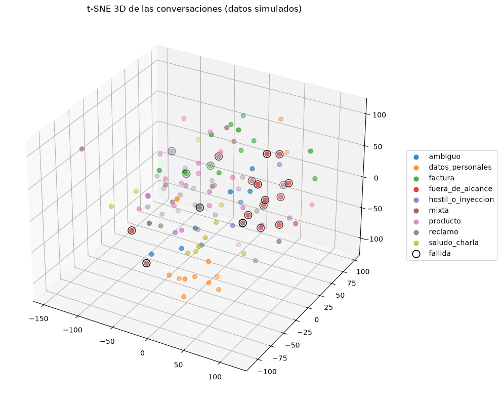

# Informe técnico final: agente de Celsia por WhatsApp

**Curso:** Técnicas avanzadas de IA aplicadas en modelos de lenguaje (Maestría en Inteligencia Artificial y Ciencias de Datos, UAO, 2026-2S)

**Grupo 4:** María Stella Fuentes Díaz, Juan José Mosquera Esquivel, Nicolás Bolaños Esterling y Jensen Fabián Tamayo Merchán

**Estado descrito:** 28 de noviembre de 2026, con mediciones del 26 y el 27 · **Sustentación:** 28 de noviembre de 2026

**Código:** https://github.com/mariastefuentes/taaml-celsia-asistente (las decisiones están en `docs/decisiones.md`)

## Resumen

Celsia publica su información en más de mil páginas y ya atiende, entre otros canales, por WhatsApp con su asistente virtual Luz I.A. Este proyecto explora un siguiente paso: preguntar con las propias palabras y recibir la respuesta con su fuente. Para eso construyó un asistente que responde con el contenido oficial de celsia.com y dice «no tengo esa información» cuando la fuente no lo trae. Tiene un agente de LangChain con **20 herramientas** de esquema Pydantic estricto, memoria por capas en PostgreSQL, aprobación humana para lo que cambia algo fuera de la conversación, una API en FastAPI, un **gateway de OpenClaw** versionado en el repositorio con un puente hacia ese agente. Un webhook propio para la API de Meta quedó en el código, pero no se usa en la demostración. Los modelos se consultan por API en la nube: no se usa ningún modelo local.

Medido con el modelo real: el 26 de noviembre, banco verificable **49 de 49**, matriz de enrutamiento **40 de 43**, ataques directos **11 de 11** y órdenes escondidas **8 de 8** sin obedecer; el 24, recuperación del dato en **32 de 35** preguntas (91 %) con 12 fragmentos. Hay **591 pruebas aprobadas y 2 omitidas** (Qdrant) de 593 pruebas automáticas (28/11); la suite corre sin modelos ni red.

Lo que **falta** se declara en la sección 11. Lo principal: falta comprobar por WhatsApp, en el computador del bot, la versión actual (reclamos, fuente, memoria y varias personas a la vez).

## 1. Problema y solución

**El problema.** Un cliente de Celsia tiene dudas básicas (cómo pagar la factura, cómo reportar un daño, dónde hay una sede, a qué hora atienden) y la respuesta está repartida entre un sitio de cientos de páginas, una línea telefónica, oficinas y un WhatsApp con el asistente virtual Luz I.A., según el blog de Celsia (2023). Este proyecto no probó ni comparó ese asistente. En un servicio público un dato inventado (un plazo, un precio, un teléfono) causa un daño real: el canal tiene que ser **preciso** y **reconocer cuando no sabe**.

**La solución.** Un agente conversacional con RAG (generación aumentada por recuperación, Lewis et al., 2020). El modelo no responde de memoria: elige una herramienta, recibe datos o fragmentos con su fuente y responde con ellos. Se construyó en tres módulos:

| Módulo | Qué entregó | Informe |
|---|---|---|
| 1. Corpus y preguntas | Scraping, capas Bronze, Silver y Gold, curaduría, 1.690 fragmentos y una aplicación de preguntas, resumen y FAQ | `informe_taller1.md` |
| 2. Agente | Agente `create_agent` con memoria, herramientas, enrutador, blindaje, API y frontend | `informe_taller2.md` (incluye la comparación de orquestadores, sección 2.2) |
| 3. Producción | 20 herramientas, PostgreSQL, aprobación humana, OpenClaw, WhatsApp, MCP y evaluación | Este documento |

## 2. Arquitectura de extremo a extremo



Hay **un solo agente** y varias entradas:

1. **OpenClaw (canal pedido en este módulo).** El gateway recibe el mensaje de WhatsApp. El plugin `puente-celsia` fija el número del remitente verificado y la herramienta MCP `atender_cliente_celsia` envía el mensaje a `POST /chat`. La respuesta vuelve sin cambios.
2. **Webhook de Meta (sin uso en la demostración).** El código recibe avisos firmados en `/webhook/whatsapp`; la demo no pasa por él (D56).
3. **Frontend React y chat web** por `POST /api/chat`, con respuesta en streaming.

Dentro de la API, el agente lee la conversación en PostgreSQL, arma el prompt v13, decide si responde o llama a una herramienta, y guarda el turno. Antes de enviar, cada cifra, correo y enlace de la respuesta se busca en lo que devolvieron las herramientas; si algo no aparece, se agrega una nota para verificarlo (avisa, no bloquea).

Un segundo servidor MCP, `celsia`, expone diez herramientas de solo lectura para clientes como OpenClaw.

## 3. Agente, enrutamiento y herramientas

El agente se construye con `create_agent` de LangChain 1.x, que corre sobre LangGraph. En cada turno el modelo recibe las 20 herramientas con su esquema (JSON Schema generado desde Pydantic) y responde con una llamada estructurada. Las 20 usan `extra="forbid"`: un argumento que no existe o un valor no permitido no llega a la herramienta y el modelo recibe qué corregir.

| Grupo | Herramientas |
|---|---|
| Conocimiento y datos oficiales (10, también por MCP) | `buscar_en_base`, `consultar_sedes`, `consultar_contactos`, `consultar_catalogo`, `consultar_canales_de_atencion`, `consultar_cobertura`, `consultar_tramite_en_linea`, `consultar_politica_de_datos`, `verificar_canal_oficial`, `calcular_factura_estimada` |
| Memoria del cliente (4) | `guardar_dato_del_cliente`, `recordar_datos_del_cliente`, `listar_datos_del_cliente`, `olvidar_dato_del_cliente` |
| Reclamos y personas (6) | `radicar_reclamo`*, `consultar_mis_reclamos`, `consultar_estado_reclamo`, `cancelar_reclamo`*, `derivar_a_asesor`, `reportar_dano_electrico`* |

\* Pasa por aprobación humana antes de ejecutarse.

**Enrutamiento.** Es del propio modelo (*function calling*), guiado por el prompt v13, que agrupa las herramientas por tarea y prohíbe gastar dos cuando una basta (D46). No hay un clasificador aparte.

**Control del ciclo.** El agente usa componentes intermedios: recorte del historial, fecha del día, manejo cortés de errores de herramientas (sin filtrar el error al cliente), resumen de conversaciones largas, tope de **4 llamadas** a herramientas por turno, aprobación humana (`HumanInTheLoopMiddleware`), validación del reclamo antes de la pausa y respaldo de modelo.

**Modelos.** Principal: `deepseek-flash`. Respaldo en cadena: `gemini-3.8-flash` y luego `deepseek-v4-pro`. Todos por API, con las claves en variables de entorno (D51).

**Aprobación humana.** Radicar un reclamo, cancelarlo o reportar un daño pausa el agente. Una persona decide en el panel en vivo (o con `POST /aprobar`) y la API le envía el resultado al cliente por el WhatsApp de OpenClaw; si no se le puede enviar, le llega con su siguiente mensaje (D56). Ese envío no se ha probado con el canal real. La pausa se guarda en PostgreSQL. Los reclamos, reportes y solicitudes de asesor son **registros simulados**: no llegan a un sistema de Celsia y `derivar_a_asesor` no transfiere la conversación ni promete tiempos.

## 4. Memoria por capas



| Capa | Qué guarda | Cómo |
|---|---|---|
| Lo que ve el modelo | Los últimos ~3.000 tokens | Recorte en cada turno |
| Resumen | Lo antiguo, cuando la conversación guardada pasa de 8.000 tokens (conserva los últimos 6 mensajes) | `SummarizationMiddleware` |
| Conversación | Todos los turnos, con sus llamadas a herramientas | `PostgresSaver`, un hilo por teléfono |
| Largo plazo | Lo que el cliente cuenta de sí mismo (máximo 20 datos) y sus reclamos | `PostgresStore`, un espacio por cliente |
| Workspace de OpenClaw | Identidad, límites y reglas de memoria del asistente | `openclaw/workspace/` |

En `POST /chat` el teléfono se convierte en un hash y el número no se guarda en la base de la API. Un cliente no puede leer lo de otro y puede listar y borrar lo que se recuerda de él (D43, Ley 1581 de 2012). Sin `DATABASE_URL` el mismo código usa SQLite.

## 5. Datos y recuperación (RAG)

**Pipeline.** celsia.com (respetando `robots.txt`) → Bronze (1.273 direcciones) → Silver y Gold (1.101 documentos) → curaduría (393 documentos, ~316.800 tokens) → 1.690 fragmentos de 1.000 caracteres con 150 de solape → embeddings `gemini-embedding-001` (768 dimensiones) → Qdrant, con categoría y región como metadatos. Los PDF del sitio no se descargaron porque su `robots.txt` los bloquea.

**Búsqueda del agente.** Cuatro fragmentos: tres por significado y el mejor por palabras que no esté ya (D31). Cada fragmento lleva su fuente y el contexto se trata como datos, no como órdenes.

## 6. Gateway OpenClaw, skills y MCP

La configuración está versionada y sin secretos en `openclaw/openclaw.example.json`; `make openclaw-check` la valida y `make openclaw-instalar` la escribe en el equipo (D47, D48). El 24 de noviembre la plantilla pasó `openclaw config validate` con OpenClaw 2026.11.6; el único aviso fue que en ese equipo falta instalar el plugin de WhatsApp (`openclaw plugins install npm:@openclaw/whatsapp`).

| Control | Valor |
|---|---|
| Gateway | `bind: loopback`, con token |
| Sesiones | Una por persona y canal (`per-channel-peer`) |
| Herramientas | Perfil `messaging`; negados automatización, ejecución, archivos y `sessions_spawn`; sin permisos elevados |
| Sandbox | `mode: all`, Docker, sin acceso al workspace; dentro solo los MCP `celsia` y `puente` |
| Modelo | `deepseek/deepseek-flash`; respaldo `deepseek/deepseek-v4-pro` (misma clave, D68) |
| Workspace | `SOUL.md` (identidad), `AGENTS.md` (límites), `USER.md`, `MEMORY.md` y bitácora |
| MCP | `celsia` (10 herramientas de solo lectura) y `puente` (`atender_cliente_celsia`) |
| Plugin | `puente-celsia` |

**El puente (D52).** El agente de OpenClaw solo veía las diez herramientas de lectura; la memoria, los reclamos y la aprobación vivían en el agente propio. Se comprobó que OpenClaw no envía el remitente a los servidores MCP, y dejar que el modelo copie el número permitiría suplantar a otro con una frase. Por eso un plugin (gancho `before_tool_call`) reemplaza el número con el que OpenClaw tiene para el chat y bloquea la llamada si no lo hay. Como a las herramientas MCP OpenClaw 2026.11.6 no les entrega el remitente, el plugin lo toma del nombre del chat directo de WhatsApp, que arma OpenClaw y no el modelo.

**Prueba hecha (25/11).** Con OpenClaw, su sandbox, un modelo falso y un canal de Telegram simulado (un adaptador de prueba presentó el nombre del chat como de WhatsApp): dos clientes quedaron atendidos cada uno en su hilo; el teléfono que el modelo intentó pasar no se usó; sin cliente, el plugin bloqueó la llamada. La primera versión bloqueaba todos los mensajes y la prueba anterior no lo detectó porque usó un número escrito a mano. **No se ha probado con WhatsApp ni con un chip real.** La respuesta pasa por dos modelos y tarda más que por el webhook; falta medir cuánto con el canal real.

Las skills de `.opencode/skills/` se usaron para construir el proyecto; el gateway no las carga.

## 7. API y canales de WhatsApp

| Ruta | Para qué |
|---|---|
| `POST /chat` | `{"mensaje", "telefono"}` → `{"respuesta", "herramientas", "ok", "pendiente"}` |
| `POST /api/chat` | Un turno en streaming para el frontend |
| `GET` y `POST /webhook/whatsapp` | Verificación y mensajes de Meta |
| `POST /aprobar` | Decisión de una persona sobre lo pendiente |
| `GET /api/salud` | Estado, modelo, almacén vectorial, memoria y allowlist |
| `GET /panel`, `GET /api/actividad` | Panel en vivo |
| `GET /api/pendientes`, `POST /api/pendientes/{código}` | Lo que espera aprobación y la decisión de una persona |
| `GET /api/hilos/{hilo}/mensajes`, `GET` y `DELETE /api/usuarios/{usuario}/datos` | Historial y datos del cliente |

La entrada se valida con Pydantic (teléfono de 7 a 15 dígitos, mensaje de 1 a 1.000 caracteres). Si el modelo falla, `POST /chat` devuelve un mensaje cortés con `ok: false`, para que el canal siempre tenga algo que responder.

**Acceso por número.** `WHATSAPP_ALLOWLIST` (formato E.164) limita quién es atendido en el puente (D52) y en el webhook (D49); con `*` o sin definir quedan abiertos. La plantilla de OpenClaw trae el canal de WhatsApp encendido y abierto al auditorio (D54); la defensa de la cuota es el límite por teléfono.

**Webhook de Meta (sin uso en la demostración).** Comprueba la firma HMAC, responde 200 de inmediato, descarta repetidos y ofrece menú con botones. En una versión anterior del agente (20 de noviembre, con el número de prueba de Meta) un celular real conversó, y un reclamo se aprobó y se rechazó con botones. Ese ensayo no se ha repetido con el agente actual.

## 8. Evaluación

| Medición (26/11/2026 salvo que se indique) | Resultado |
|---|---|
| Banco verificable: 49 preguntas con la respuesta calculada desde los datos | **49 de 49**, con conversación 8/8 y aislamiento 1/1 (antes del ajuste de D66, el mismo día: 48 de 49) |
| Matriz de enrutamiento: 43 preguntas (D53) | Ruta **40 de 43**, parámetros 15 de 15, texto 9 de 10 (el 24/11: 41, 14 y 9) |
| Ataques directos (11 intentos de saltarse las reglas) | **11 de 11** resistidos (26/11) |
| Preguntas hostiles (22) | Sin fallas automáticas; 2 eran de leer a mano y están bien (26/11) |
| Latencia por turno, sin canal | En el banco, mediana 3,0 s; la primera pregunta, en frío, 22,0 s y las demás hasta 15,4 s. En la matriz, mediana 2,8 s y máximo 15,9 s |
| Inyección indirecta (8 órdenes escondidas en lo que devuelven las herramientas) | **8 de 8** sin obedecer (26/11, leídas a mano; la regla automática marcó una falsa alarma). Se corrió con un guion de apoyo que no está en el repositorio |
| Pruebas automáticas (28/11) | 591 aprobadas y 2 omitidas (Qdrant), 593 en total, sin modelos ni red |
| Revisión con navegador (27/11, Playwright, `make qa`) | 14 de 14 con un servidor propio; 10 y 4 omitidas con el índice y el modelo reales. Encontró dos errores del chat web, ya corregidos (`docs/qa_playwright.md`) |

**Recuperación** (35 preguntas con respuesta):

| Método | 12 fragmentos | 8 fragmentos | nDCG@10 | recall@10 |
|---|---|---|---|---|
| Por palabras | 54 % | 51 % | 0,290 | 0,254 |
| Híbrido | 89 % | 80 % | 0,479 | 0,485 |
| Embeddings | **91 %** | 83 % | 0,572 | 0,529 |

Con lo que ve el agente (mezcla, 4 fragmentos) el dato aparece en **28 de 35** (80 %); su nDCG@10 es 0,565 y su recall@10, 0,524.

El recall@10 es la fracción de **todos** los fragmentos relevantes del corpus que entra en los 10 primeros (relevante: cumple el patrón de la intención de la pregunta). Se midió el 24/11 (`scripts/21_metricas_ranking.py`).

**Lo que estas cifras no dicen.**
- Las 35 preguntas son las mismas con las que se ajustó el diccionario de sinónimos: con preguntas nuevas el acierto sería menor. Diferencias de una o dos preguntas no demuestran que un método sea mejor.
- Las expectativas de la matriz se redactaron **después** de ver una corrida con las 20 herramientas: no es una evaluación a ciegas. Fallan R08 (pide una aclaración en vez de consultar el horario), R16 (da canales y enlace pero no busca los pasos) y R17 (da la atención presencial de Planadas pero no busca los trámites en el texto).
- Cada medición con modelo es una corrida; el enrutamiento varía entre corridas.
- Un banco al 100 % no garantiza que no haya alucinaciones en preguntas nuevas.

## 9. Seguridad

- **Datos como datos.** El contexto recuperado se limpia de caracteres invisibles y de cierres falsos del bloque; el modelo tiene la orden de no obedecer instrucciones dentro de los datos.
- **Acciones.** Lo que cambia algo fuera de la conversación exige una persona.
- **Datos personales.** No se piden cédulas, claves ni tarjetas; la política está en `docs/politica_de_privacidad.md`.
- **Acceso.** `POST /chat` exige `X-Api-Key` si el servidor define `CHAT_TOKEN`; `POST /aprobar`, el panel y los pendientes exigen `X-Aprobador`; el webhook exige la firma de Meta. La API solo le escribe a un cliente por OpenClaw si hay `CHAT_TOKEN`.
- **Chat web y teléfonos.** Las rutas del chat web solo aceptan los identificadores al azar que crea el navegador, así que no sirven para leer ni borrar una conversación por teléfono; sin `CHAT_TOKEN`, `/chat` rechaza lo que llega por un túnel (D73).
- **Abuso.** Límite de 8 mensajes por minuto por teléfono.
- **OpenClaw.** Controles de la sección 6. **Falta** correr `openclaw security audit` sobre la configuración final y guardar su salida.
- **Secretos.** Ningún `.env` en el repositorio; una prueba revisa que la plantilla no tenga claves.

## 10. Análisis de conversaciones con t-SNE y UMAP (opcional)

> Vectores, figuras y cifras recalculados el 26/11 con Gemini (`gemini-embedding-001`), sobre las mismas conversaciones de antes: las respuestas no se volvieron a generar (D71).

**Datos.** 114 conversaciones **simuladas**: las preguntas las escribió el equipo y las respondió el agente de entonces. No describen a clientes reales.





- **Los vectores capturan el tema.** K-means, sin ver la categoría, recupera la estructura con un índice de Rand ajustado de 0,53. KNN (5 vecinas) acierta la categoría el 74 % de las veces en el espacio original, el 67 % en el t-SNE 3D y el 69 % en el 2D, contra 18 % del azar. Para buscar conversaciones parecidas se usa el espacio original; t-SNE sirve para mirar.
- **Dónde fallaba.** De 20 conversaciones marcadas como fallidas (18 %), al leerlas: 15 eran rechazos correctos, 3 vacíos de la base y 2 fallos reales. La tasa de fallo útil fue 5 de 114 (4 %).

**PCA, t-SNE y UMAP.** Confiabilidad de vecinos (k=5): PCA 0,848, t-SNE 0,968 y UMAP 0,958 (D71).


## 11. Pendientes y limitaciones

| Pendiente al 26/11 | Efecto |
|---|---|
| Guardar la prueba del puente desde un teléfono externo y probar en el equipo del bot el aviso de aprobación | Es el criterio del canal |
| Probar el modelo de respaldo (D68) y el gateway como servicio en el equipo del bot | El respaldo solo se probó en otro equipo, y el servicio nunca |
| Correr `openclaw security audit` sobre la configuración final | Evidencia de endurecimiento |

**Limitaciones.**
- El sistema corre en un computador local: si se apaga o cambia de red, deja de responder.
- Reclamos, reportes y solicitudes de asesor son simulados.
- Varias personas a la vez solo se probaron sin WhatsApp (26/11: 3 y 8 simultáneas, 11 de 11 bien, hasta 10 s).
- El índice vectorial no se versiona: cada copia lo reconstruye con `make indice` y una clave de Google. Si la API de embeddings falla, la búsqueda cae a palabras (54 %).
- Tres datos que Celsia no publica (precio del cargador, fecha límite de pago, facturación por estimación) no están en la base; el agente lo dice.
- Las evaluaciones son pequeñas: sirven para detectar fallos, no para estimar el desempeño con clientes.

## 12. Conclusiones

El proyecto tiene un agente con 20 herramientas de esquema estricto, memoria que sobrevive en PostgreSQL, una persona en el circuito de los reclamos y un gateway versionado que llega a ese mismo agente por un puente que no confía en el modelo para saber quién escribe. Dos decisiones marcan el resultado: tratar lo recuperado como datos y no como órdenes, y dejar en manos de personas y del canal verificado lo que no debe decidir el modelo.

Lo más valioso fue **medir** cada cambio: así se vio que dos herramientas redundantes confundían el conteo de sedes (D50) y que la matriz vieja ya no describía al agente (D53). Lo más frágil no es el agente sino lo que lo rodea: un número por vincular, un computador local y configuraciones que deben coincidir entre equipos.

## Anexo A. Reproducir

```
uv sync
make indice              # reconstruye el índice del corpus versionado (requiere GOOGLE_API_KEY, unos 2 minutos)
make corpus              # corpus completo con un comando: descarga celsia.com, limpia, fragmenta e indexa (modifica data/)
make api                 # API con PostgreSQL local, puerto 8000
make openclaw-check      # valida la plantilla de OpenClaw sin escribir
make openclaw-instalar   # escribe la configuración y copia el workspace
make test                # pruebas, sin modelos ni red
make chat-web && make qa # revisión con navegador (Playwright), sin modelos ni costo
make verificar-clon      # clona GitHub y corre lint y pruebas en una carpeta vacía
make banco-verificable   # 49 preguntas con el modelo real (gasta cuota)
uv run python scripts/22_matriz_enrutamiento.py      # matriz de enrutamiento (gasta cuota)
uv run python scripts/10_evaluar_recuperacion.py --k 12
```

## Anexo B. Mapa de la rúbrica

| Criterio (peso) | Dónde está la evidencia | Estado |
|---|---|---|
| 1.1 Veinte herramientas tipadas (10 %) | Sección 3; `src/taaml/agente.py` | Hecho |
| 1.2 Enrutamiento y planificación (8 %) | Secciones 3 y 8 | Medido: 40/43 |
| 1.3 Memoria por capas (7 %) | Sección 4 | Hecho; ensayar el reinicio en vivo |
| 2.1 Pipeline de datos (5 %) | Sección 5; `scripts/01` a `07` | Hecho |
| 2.2 RAG sobre Qdrant con citas (6 %) | Secciones 5 y 8 | Hecho |
| 2.3 Evaluación del conocimiento (4 %) | Secciones 8 y 10 | Hecho |
| 3.1 Gateway OpenClaw (8 %) | Sección 6 | Plantilla con respaldo (D68); falta el servicio y el equipo de la demo |
| 3.2 WhatsApp con allowlist E.164 (10 %) | Secciones 6 y 7 | Canal abierto a propósito (D54); **pendiente: comprobar la versión actual por WhatsApp** |
| 3.3 Workspace (7 %) | Sección 6; `openclaw/workspace/` | Hecho; bitácora con una entrada (26/11) |
| 3.4 Skills y MCP (5 %) | Sección 6 | Hecho; mostrar la invocación en vivo |
| 4.1 Código y pruebas (7 %) | Sección 8; CI | Hecho |
| 4.2 Seguridad (7 %) | Sección 9 | Falta `security audit` final |
| 4.3 Documentación (6 %) | Este informe, README, manual de uso, `docs/decisiones.md`, guía de despliegue | Hecho |
| 5.1 y 5.2 Sustentación (10 %) | `docs/guion_sustentacion_final.md` | Por ensayar |

## Anexo C. Declaración de uso de IA

| Herramienta | Para qué se usó | Cómo se verificó |
|---|---|---|
| Claude Code (Anthropic) | Escribir y revisar código, pruebas y documentos, incluido este informe | Cambios por pull request; pruebas y linter en CI; las cifras salen de los scripts del repositorio; el equipo debe poder explicar el código en vivo |
| `deepseek-flash` (API) | Modelo del agente y de OpenClaw | Banco, matriz, ataques y preguntas hostiles (sección 8) |
| `gemini-3.8-flash` y `deepseek-v4-pro` (API) | Respaldo del agente; Gemini fue además el modelo del Módulo 2 | El respaldo tiene pruebas automáticas; su calidad no se midió aparte |
| `gemini-3.5-flash` (API) | Modelo de preguntas, resumen y FAQ del Módulo 1 | Evaluación con 59 preguntas (`informe_taller1.md`) |
| `gemini-embedding-001` (API) | Embeddings de fragmentos y preguntas | Recuperación y ranking (sección 8) |
| `nomic-embed-text-v2-moe` y `llama3.2` (locales, retirados) | Embeddings y respaldo antes de D51 | Declarado como evidencia anterior |
| LangSmith | Trazas de cada turno | Comparación de la traza con la respuesta |

## Referencias

- Lewis, P. et al. (2020). *Retrieval-Augmented Generation for Knowledge-Intensive NLP Tasks*. arXiv:2005.11401.
- Yao, S. et al. (2022). *ReAct: Synergizing Reasoning and Acting in Language Models*. arXiv:2210.03629.
- Schick, T. et al. (2023). *Toolformer: Language Models Can Teach Themselves to Use Tools*. arXiv:2302.04761.
- van der Maaten, L. y Hinton, G. (2008). *Visualizing Data using t-SNE*. Journal of Machine Learning Research, 9.
- Greshake, K. et al. (2023). *Not what you've signed up for: Compromising Real-World LLM-Integrated Applications with Indirect Prompt Injection*. arXiv:2302.12173.
- Documentación de LangChain (docs.langchain.com), Model Context Protocol (modelcontextprotocol.io), OpenClaw (docs.openclaw.ai) y la API Cloud de WhatsApp (developers.facebook.com).
- Ley 1581 de 2012 de Colombia (protección de datos personales).
