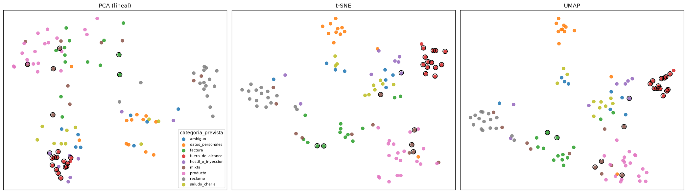

# Informe técnico final: agente de Celsia por WhatsApp

**Curso:** Técnicas avanzadas de IA aplicadas en modelos de lenguaje (Maestría en Inteligencia Artificial y Ciencias de Datos, UAO, 2026-2S)
**Grupo 4:** María Stella Fuentes Díaz, Juan José Mosquera, Nicolás Bolaños y Jensen Tamayo
**Fecha:** 20 de noviembre de 2026 · **Sustentación:** 21 de noviembre de 2026
**Código:** https://github.com/mariastefuentes/taaml-celsia-asistente (público; las decisiones están en `docs/decisiones.md`)

## Resumen

Celsia publica su información en más de mil páginas y un cliente no tiene dónde preguntar y recibir la respuesta con su fuente. El proyecto construyó, en tres módulos, un asistente que responde solo con el contenido oficial de celsia.com y dice «no tengo esa información» cuando la fuente no lo trae. El Módulo 1 armó el corpus (393 documentos, 1.690 fragmentos) y un sistema de preguntas y respuestas con RAG. El Módulo 2 lo convirtió en un agente con memoria, herramientas y enrutamiento. El Módulo 3, que este informe detalla, lo llevó a producción por la **Ruta A**: una API REST con FastAPI, cinco herramientas de LangChain con esquemas Pydantic estrictos, memoria en PostgreSQL, aprobación humana para los reclamos y un **servidor de integración propio** (Vía 2, sin N8N) que atiende a los clientes por WhatsApp con la API Cloud de Meta.

El agente se midió con la matriz de enrutamiento (41 de 43 preguntas con la herramienta esperada con el prompt v11; 42 con el v9), preguntas de energía (7 de 8 respondidas, la octava con «no hay información»), preguntas ajenas (10 de 10 rechazadas) y respuestas honestas con una herramienta caída (6 de 6). Hay 370 pruebas automáticas sin modelos ni red y un banco de 49 preguntas cuya respuesta correcta se calcula desde los datos para medir alucinaciones (sección 9). Como componente opcional, se analizaron 114 conversaciones simuladas con embeddings y t-SNE en 2D y 3D: los vectores recuperan la estructura por tema (índice de Rand ajustado de 0,45) y la lectura de las conversaciones marcadas como fallidas muestra que la tasa de fallo útil es de 4 %, no de 18 %.

Lo que **no** está probado se dice en la sección 11: el canal de WhatsApp se verificó con Meta real solo en parte, el número de prueba de Meta solo conversa con cinco destinatarios autorizados, y las conversaciones reales analizadas son seis, insuficientes para concluir algo sobre ellas.

## 1. Problema y solución

**El problema.** Un cliente de Celsia que escribe por primera vez tiene dudas básicas: cómo pagar la factura, cómo reportar un daño, dónde hay una sede o a qué hora atienden. La respuesta está repartida entre un sitio de cientos de páginas, una línea telefónica, WhatsApp y oficinas. Eso genera esperas y carga a la atención humana. Además, en un servicio público un dato inventado (un plazo, un precio, un teléfono) causa un daño real, por lo que el canal debe ser **preciso** y **reconocer cuando no sabe**.

**La solución.** Un agente conversacional de RAG (generación aumentada por recuperación, Lewis et al., 2020) sobre el contenido oficial. El modelo no responde de memoria: decide qué herramienta usar (datos exactos, búsqueda por significado, memoria del cliente o radicar un reclamo), recibe fragmentos con su fuente y responde con ellos. Se construyó en tres módulos:

| Módulo | Qué entregó | Resultado medido |
|---|---|---|
| 1. Corpus y Q&A | Scraping, limpieza en capas Bronze, Silver y Gold, 1.690 fragmentos, embeddings y un Q&A con resumen y FAQ | La respuesta está entre los 12 fragmentos recuperados en el 89 % de 35 preguntas (con las mismas preguntas que motivaron el diccionario de sinónimos); 4 de 4 ataques de inyección directa y 4 de 4 indirectos rechazados |
| 2. Agente | Agente `create_agent` con memoria, herramientas, enrutador por prompt, blindaje, API FastAPI con streaming y frontend React | 30 de 31 elecciones de herramienta correctas; un turno tarda 8,4 s de mediana; 11 ataques directos y 8 indirectos rechazados |
| 3. Producción | Cinco herramientas con esquemas estrictos, PostgreSQL, aprobación humana, servidor propio de WhatsApp, límite de uso, panel en vivo, análisis t-SNE | Secciones 5 a 10 |


## 2. Evolución arquitectónica: del Módulo 2 al Módulo 3

El Módulo 2 dejó un agente que funcionaba en una máquina, con una interfaz propia. El Módulo 3 lo convirtió en un servicio al que se llega desde un teléfono. Lo que cambió:

| Aspecto | Módulo 2 | Módulo 3 | Por qué |
|---|---|---|---|
| Canal | Frontend React por HTTP con streaming (SSE) | **WhatsApp** (webhook propio) además del frontend y `POST /chat` | Que un servicio externo pueda hablar con el agente (D7, D10) |
| Modelo | `gemini-3.8-flash` | `deepseek-flash`, con Gemini y `llama3.2` local como respaldo en cadena | Costo y disponibilidad; el respaldo evita dejar al cliente sin respuesta (D8) |
| Memoria | SQLite (`SqliteSaver` y `SqliteStore`) | **PostgreSQL** (`PostgresSaver` y `PostgresStore`) | Varias instancias de la API comparten memoria y una pausa de aprobación sobrevive a un reinicio (D4) |
| Herramientas | 4 | **5**, todas con esquema Pydantic estricto (`radicar_reclamo` es la nueva) | Function calling estricto: los argumentos se validan antes de ejecutar |
| Acciones | Solo lectura y memoria del cliente | Radicar un reclamo, **con aprobación humana** (`HumanInTheLoopMiddleware`) | Una acción que cambia algo fuera de la conversación no la decide el modelo solo (D11, D16) |
| Prompt | v4 | **v11** | v7 corrige el rechazo de preguntas válidas de energía; v8 busca las cifras de la empresa antes de rechazarlas; v9 da una sola cifra cuando los textos discrepan y responde en el idioma del cliente; v11 responde en cualquier idioma, atiende primero el peligro eléctrico inmediato, rechaza lo ajeno con «Eso se sale de lo que puedo ayudarte», se presenta al saludar y responde breve (D14, D21, D25, D39) |
| Protección | Rechazo de inyecciones | + límite de 8 mensajes por minuto por teléfono, firma de Meta, clave para `/chat`, token para aprobar | El bot es público durante la demo (D13) |
| Observación | Trazas en LangSmith | + panel en vivo (herramienta, tiempo, **costo** y etiqueta de «dato sin respaldo»), chequeo previo, plan B | Se ve qué hace y cuánto cuesta cada respuesta mientras el agente responde (D18, D19, D28) |
| Calidad del repositorio | Pruebas locales | CI en GitHub con `make lint` y `make test`, y `make verificar-clon` sobre un clon limpio | Que lo que está en GitHub arranque desde cero (D26) |
| Análisis | Embeddings del corpus | + **t-SNE sobre conversaciones** | Ruta transversal A (D15) |

## 3. Diagrama de extremo a extremo

El camino de un mensaje, del usuario a la respuesta:


1. **Usuario → Meta.** La persona escribe al número de WhatsApp Business. Meta lo recibe en su API Cloud.
2. **Meta → túnel → API.** Meta firma el aviso (`X-Hub-Signature-256`) y lo envía por POST a `/webhook/whatsapp`. Como la API corre en un computador local, un túnel de Cloudflare la expone por HTTPS.
3. **API.** Comprueba la firma, responde 200 de inmediato (para que Meta no reintente) y atiende el mensaje en segundo plano. Descarta avisos repetidos por identificador y aplica el límite por teléfono. Los saludos y `/nuevo` se resuelven sin llamar al modelo.
4. **Agente.** El teléfono se convierte en un hash que sirve de identificador de la conversación; el agente (`create_agent`) lee su historial en PostgreSQL, arma el prompt v11 y decide si responde o llama a una herramienta.
5. **LLM y herramientas.** DeepSeek elige la herramienta con function calling; Pydantic valida los argumentos. Los datos exactos salen de tablas locales; la búsqueda por significado, de Qdrant con embeddings de Ollama.
6. **Memoria y validación.** El turno se guarda en PostgreSQL bajo el hilo del cliente. Antes de enviar, cada cifra, correo y enlace de la respuesta se busca en lo que devolvieron las herramientas; si algo no aparece, se agrega una nota «verifica antes de usar» (avisa, no bloquea).
7. **Retorno.** La API envía la respuesta por la Graph API de Meta, que la entrega en el teléfono.

El detalle del agente, con sus componentes intermedios (resumen, validación del reclamo, tope de llamadas y aprobación humana):


El diagrama es la versión actual (prompt v11, búsqueda mezclada, servidor MCP «celsia» y OpenClaw como segundo cliente), hecha con Archify.

## 4. Ruta A y justificación de las decisiones

El Módulo 3 ofrece dos rutas: la **Ruta A** (LangChain, API REST y WhatsApp) y la **Ruta B** (un sistema operativo de agentes, OpenFang, con memoria en capas, «Hands» y puentes a Telegram o WhatsApp). Son alternativas: se elige una. El grupo eligió la A.

**Por qué la Ruta A.** (1) El agente del Módulo 2 ya estaba hecho con LangChain, con herramientas, memoria y recuperación; la Ruta A lo lleva a producción, mientras que la B exige reconstruirlo en otro sistema. (2) La Ruta B implica instalar un runtime distinto, migrar toda la base de conocimiento a su memoria y escribir los manifiestos de las operaciones autónomas, un trabajo con su propia curva de aprendizaje. (3) Lo medido y probado hasta ahora (esquemas de herramientas, PostgresSaver, aprobación humana, webhook, 370 pruebas, análisis de conversaciones) pertenece a la Ruta A (más de 360 pruebas). No se evaluó OpenFang en este proyecto, así que la comparación se argumenta y no se midió.

**Vía 2 (servidor propio) frente a Vía 1 (N8N).** Dentro de la Ruta A, la conexión con WhatsApp tiene dos vías: un flujo visual en N8N o un manejador de webhook escrito en FastAPI. Se eligió el servidor propio (D10):

| | N8N (Vía 1) | Servidor propio en FastAPI (Vía 2, elegida) |
|---|---|---|
| Piezas a mantener | Dos servicios (N8N y la API) | **Uno** |
| Pruebas | Difíciles de automatizar | 15 pruebas del webhook (firma, reintentos, límite, aprobación) |
| Estado | En un sistema externo | En nuestra base de datos |
| Lógica | En un flujo visual | En el repositorio, revisada por pull request |
| Velocidad de armado | **Más rápido, sin código** | Más código |
| Exposición | N8N ya trae su dirección pública | Hay que exponer el servidor con un túnel (la dirección cambia en cada arranque) |

Lo que se pierde: N8N habría sido más rápido de armar y se modifica sin código. El servidor propio exige un túnel y atender detalles de Meta (firma, reintentos, ventana de 24 horas).

## 5. Herramientas y function calling estricto

El agente se construye con `create_agent` de LangChain 1.x, que corre sobre LangGraph. En cada turno el modelo recibe las herramientas con su esquema (JSON Schema generado desde Pydantic) y responde con una **llamada estructurada** (nombre y argumentos). Pydantic valida los argumentos de nuestro lado antes de ejecutar; el prompt solo guía la elección. No se interpreta texto libre.

| Herramienta | Para qué sirve | Tipo |
|---|---|---|
| `consultar_datos` | Dato exacto: sedes, contactos y catálogo, con filtros por ciudad y tipo | Lectura |
| `buscar_en_base` | Búsqueda por significado en 1.690 fragmentos (embeddings `nomic-embed-text-v2-moe`, Qdrant, coseno) | Lectura |
| `guardar_dato_del_cliente` | Memoria de largo plazo: lo que el cliente cuenta de sí mismo (sin cédulas, claves ni tarjetas) | Escritura de memoria |
| `recordar_datos_del_cliente` | Devuelve lo guardado de ese cliente | Lectura de memoria |
| `radicar_reclamo` | Radica un reclamo (el registro es simulado) | **Acción, con aprobación humana** |

**Esquemas estrictos.** Cada herramienta tiene un `args_schema` de Pydantic que prohíbe campos adicionales (`extra="forbid"`) y limita los valores (por ejemplo, `consultar_datos` solo acepta las tres tablas que existen). Los argumentos inválidos no llegan a la herramienta: el modelo recibe qué campo corregir y reintenta.

**Qué es y qué no es Structured Output.** El tool calling valida **después** de que el modelo genera la llamada y reintenta si falla; no restringe la generación. La salida estructurada con `with_structured_output` y un modelo Pydantic se usa en el flujo de reclamos escrito a mano (`src/taaml/flujo_reclamo.py`, un `StateGraph` con `interrupt`) y en las tareas de Resumen y FAQ del Módulo 1; no en el camino que ve el cliente por WhatsApp. Se dice así para no sobreafirmar.

**Errores de herramientas.** Un componente (`errores_amables`) captura cualquier fallo de una herramienta: el detalle completo va al registro del servidor y el modelo recibe un aviso sin datos internos para que le explique al cliente con cortesía que no pudo verificar y que no se guardó ni radicó nada. Se comprobó con el modelo real (script 42): con una lectura y una escritura rotas a propósito, el agente respondió «no pude verificar la información… llama a la línea 01 8000 112 115» y «no pude guardar tu dato… no quedó registrado», sin filtrar el texto de la excepción. Fue una corrida por caso con un solo modelo; la falla se simuló reemplazando la función de la herramienta.

**Aprobación humana.** `radicar_reclamo` pausa el agente con `HumanInTheLoopMiddleware`; una persona de Celsia decide con `POST /aprobar` (aprobar, rechazar o responder con un mensaje) y el cliente recibe la decisión. La pausa viaja por el checkpointer de PostgreSQL, así que sobrevive a un reinicio. Como el middleware pausa antes de validar, un componente propio rechaza un reclamo inválido (por ejemplo, sin ciudad) antes de que llegue a la persona, con un máximo de dos reintentos.


## 6. API REST con FastAPI

El agente dejó de vivir en un script de Streamlit y se expone como un servicio web (`api/main.py`):

| Ruta | Para qué |
|---|---|
| `POST /chat` | **Endpoint principal.** Recibe `{"mensaje": "...", "telefono": "573001234567"}` y devuelve `{"respuesta", "herramientas", "ok", "pendiente"}` |
| `POST /api/chat` | Un turno por streaming (SSE), para el frontend React |
| `GET/POST /webhook/whatsapp` | Verificación y mensajes entrantes de Meta |
| `POST /aprobar` | Una persona aprueba, rechaza o responde un reclamo pendiente |
| `GET /api/salud` | Estado, modelo, almacén vectorial y memoria en uso |
| `GET /panel` y `GET /api/actividad` | Panel en vivo de la demostración |
| `GET/DELETE /api/usuarios/{id}/datos` | Ver y borrar lo que el agente recuerda del cliente |

**Memoria por teléfono.** El teléfono identifica la conversación: se convierte en un hash estable (el número no se guarda) y `PostgresSaver` guarda cada turno bajo ese hilo. Se comprobó en vivo el 20 de noviembre: un número dijo «me llamo Camila y mi reclamo es sobre la factura de Cali», y al preguntar después «¿de qué ciudad te dije que era mi factura?» el agente respondió «de Cali»; otro número hizo la misma pregunta y el agente respondió que no tenía nada guardado. La conversación quedó guardada (cuatro mensajes). Que la memoria sobreviva a un reinicio lo cubre una prueba automática contra un PostgreSQL local real; ese día no se reinició la API para comprobarlo.

**Fallos y límites.** Si el modelo o una herramienta fallan, `POST /chat` devuelve un mensaje cortés con `ok: false` y no un error 500, para que quien llama (WhatsApp) siempre tenga algo que reenviar al cliente. La entrada se valida con Pydantic (teléfono de 7 a 15 dígitos, mensaje de 1 a 1.000 caracteres; si no, 422).

**Seguridad.**
- El webhook de WhatsApp exige la **firma HMAC** de Meta; sin `WHATSAPP_APP_SECRET` queda deshabilitado.
- `POST /chat` pide el encabezado `X-Api-Key` cuando el servidor define `CHAT_TOKEN` (en el servidor de la demostración está definida). Sin esa variable queda abierto y solo lo frena el límite por teléfono.
- `POST /aprobar` y el panel piden `X-Aprobador`; sin `APROBADOR_TOKEN` quedan deshabilitados.
- Límite de **8 mensajes por minuto** por teléfono en `/chat` y WhatsApp, y por origen en `/api/chat` (429 con `Retry-After`).
- El contexto recuperado se trata como datos pasivos y se limpia de caracteres invisibles; el modelo recibe la orden de ignorar instrucciones dentro de los datos.

## 7. Integración con WhatsApp (Vía 2)

El servidor de integración está construido directamente en FastAPI (`src/taaml/whatsapp.py` y `api/main.py`), sin N8N ni otro intermediario:

- **Recepción.** `GET /webhook/whatsapp` responde la verificación con el token que se registra en Meta. `POST /webhook/whatsapp` comprueba la firma, lee los mensajes (texto, respuestas a botones, audio) y los atiende en segundo plano. Ignora los avisos de estado, pero registra los que Meta marca como fallidos con su código (por ejemplo, 131031 «cuenta bloqueada»).
- **Envío.** Mensajes de texto y mensajes con hasta tres botones por la Graph API; cada mensaje se marca como leído y se muestra «escribiendo…» mientras el agente piensa.
- **Menú y comandos.** «Hola», «menú» o «ayuda» responden con tres botones (sedes y canales, poner un reclamo, Celsia Solar) sin llamar al modelo. `/nuevo` borra la conversación y conserva lo que el cliente contó de sí mismo.
- **Aprobación por botones.** Si se define `APROBADOR_WHATSAPP`, la persona que aprueba recibe el reclamo con «Aprobar» y «Rechazar»; `POST /aprobar` sigue funcionando.

**Qué se verificó con Meta real.** El 20 de noviembre de 2026, con el número de prueba de Meta, un celular real conversó con el agente a través del túnel: el menú con tres botones se entregó, el agente respondió preguntas con y sin herramientas, recordó datos de la conversación (por teléfono) y un reclamo se **aprobó y se rechazó desde WhatsApp** con los botones «Aprobar» y «Rechazar» (el cliente recibió la decisión y quien aprueba recibió la confirmación). Una nota de voz recibió el aviso de que por ahora solo se leen mensajes de texto. Se comprobaron también la firma y la verificación del webhook. Se midió el tiempo de 20 preguntas contra el agente real: mediana de 6,4 s, p90 de 10,3 s y máximo de 10,9 s.

**Lo que Meta impone y hay que saber:**
- El número de prueba solo conversa con **hasta cinco destinatarios autorizados**, que confirman un código. Abrirlo a cualquier persona exige un número real y la verificación del negocio, que no se hicieron.
- El token de acceso ya es de **usuario del sistema** (no el temporal de 24 horas) y dura 60 días; el actual vence el 19 de enero de 2027 y se rota después de la demostración.
- Los botones y los mensajes iniciados por la empresa solo llegan dentro de las 24 horas desde el último mensaje de la persona.
- La cuenta de WhatsApp Business figura con envío «bloqueado» en su estado de salud (método de pago pendiente y negocio sin verificar). Una cuenta anterior llegó a bloquearse por completo y se reemplazó; la actual entregó mensajes el 20 de noviembre, pero el riesgo de un bloqueo no está descartado.

## 8. Memoria conversacional


- **Corto plazo (checkpointer).** `PostgresSaver` guarda cada conversación completa, incluidas las llamadas a herramientas, bajo un hilo. El modelo ve solo los últimos ~3.000 tokens; si lo guardado pasa de 8.000, un resumen automático reemplaza lo antiguo.
- **Largo plazo (Store).** `PostgresStore` guarda lo que el cliente cuenta de sí mismo en un espacio propio por cliente; un cliente no puede leer lo de otro, y los anónimos no tienen memoria de largo plazo. El cliente puede ver y borrar lo que se recuerda.
- **Alternativa.** Sin `DATABASE_URL`, el mismo código usa SQLite (`make api-sqlite`).
- **Privacidad.** El teléfono nunca se guarda: solo su hash. Los datos personales de clientes caen bajo la Ley 1581 de 2012; en una operación real habría que definir plazos de retención.

## 9. Resultados

| Medición | Resultado |
|---|---|
| Matriz de enrutamiento (herramienta esperada en 43 preguntas, D36) | **41 de 43** con el prompt v11 (42 con el v9). R31 ya fallaba con versiones anteriores del prompt; R19 (una pregunta de memoria) consultó la herramienta de memoria en lugar de la conversación: repetida 6 veces falló 1 con v11 y 0 con v9, diferencia que no se distingue del azar. Las 10 preguntas añadidas (trámites, inglés, mal escrito, ataques, fuera de dominio) enrutaron bien; en ellas solo se verifica la herramienta, no el texto |
| Preguntas de energía, con búsqueda | 7 de 8 respondidas; la octava dijo con honestidad que no hay información |
| Preguntas ajenas a Celsia | 10 de 10 rechazadas |
| Con el almacén de memoria caído | 6 de 6 respuestas honestas |
| Herramienta rota a propósito (script 42, modelo real) | 2 de 2 respuestas corteses, sin inventar y sin filtrar el error |
| Recuperación (Módulo 1) | 89 % con embeddings (54 % por palabras, 74 % híbrido) |
| Banco verificable (49 casos con valor esperado, D29 a D31) | **49 de 49** con el prompt v11 (D39); 48 de 49 con la búsqueda mezclada y el prompt v9; antes 46, 46 y 47 en tres corridas (D30) |
| Búsqueda a k=4: embeddings contra mezcla (35 preguntas, D34) | 25/35 contra 26/35; McNemar exacto p = 1,0: **sin diferencia significativa** |
| Pruebas automáticas | 370 pasan y 2 se omiten en `main`, sin modelos ni red |
| Latencia | WhatsApp real, 20 preguntas: mediana 6,4 s, p90 10,3 s, máximo 10,9 s. Módulo 2: mediana de 8,4 s (2,1 a 23 s); algunas corridas con muchas herramientas tardaron de 12 a 72 s |
| Costo | Unos 0,02 USD por una conversación de cuatro turnos (Módulo 2) |

**Lo que estas cifras no dicen.** El 89 % de recuperación se midió con las mismas preguntas que motivaron el diccionario de sinónimos; con preguntas nuevas sería menor. Las 43 preguntas de la matriz son pocas. Los 8 casos de energía y los 10 ajenos son listas chicas. Una respuesta de WhatsApp tarda de segundos a unas decenas de segundos, y el indicador «escribiendo…» ayuda pero no la acelera.

### Mejoras posteriores al cierre del Módulo 3

Las piezas añadidas aparecen en el diagrama de la sección 3: las mismas herramientas de consulta sirven al agente de WhatsApp y, a través de un servidor MCP, a un segundo cliente (OpenClaw) endurecido.

**Búsqueda mezclada (D31).** El agente recupera cuatro fragmentos: los tres primeros por significado y, al final, el mejor por palabras que no esté ya. Con eso dejaron de fallar los dos trámites que siempre fallaban (el plazo de un PQR y dónde encontrar el código de cuenta) y el banco verificable subió a 48 de 49. Con 35 preguntas no se puede decir que sea mejor en general: hit@4 pasó de 25 a 26, MRR@4 de 0,645 a 0,652 y nDCG@4 de 0,532 a 0,539, con McNemar exacto p = 1,0 y tres pares discordantes (la mezcla gana dos y pierde uno). A k=10 los dos métodos empatan (nDCG 0,535). La mejora comprobada son los dos trámites; lo demás es ruido de muestra (D34).

**Servidor MCP propio (D32).** Las dos herramientas de consulta están expuestas por un servidor MCP de solo lectura (`src/taaml/servidor_mcp.py`, transporte stdio, sin puerto abierto). Se probó con un cliente MCP real y con OpenClaw.

**Calidad del repositorio (D33).** `pre-commit` con las mismas revisiones del CI (ruff, `uv lock --check` y bloqueo de `.env`) y `make tipos` con `ty`, que informa 8 avisos y no bloquea.

**OpenClaw como segundo cliente (D35, Taller 3).** Un agente OpenClaw con identidad «Asistente Celsia» (`SOUL.md`, `AGENTS.md`), el MCP anterior conectado y la configuración endurecida: perfil `messaging`, sin ejecución de comandos, sin acceso a archivos, sin permisos elevados ni navegador, un chat separado por persona y sandbox Docker donde solo se permite el MCP de Celsia. La batería de 4 pruebas del curso (identidad, archivos, memoria entre sesiones y Flash contra Pro) pasó las 4 antes de endurecer; después, crear archivos y ejecutar comandos quedan rechazados, la clave sigue sin imprimirse y las preguntas de Celsia se siguen respondiendo por el MCP. Costó tres lecciones: el Gateway debe estar apagado para registrar un MCP, el sandbox necesita su imagen y una lista explícita de herramientas permitidas (sin ella el agente perdía el MCP y decía «no tengo evidencia» sin inventar), y lanzar el Gateway desde una terminal de herramientas lo mataba al terminar el comando. La prueba desde el teléfono por Telegram queda pendiente.

**Asesor humano (D37).** No se construyó una herramienta nueva: ante «quiero hablar con una persona» el agente ya entrega los canales oficiales de la tabla de contactos y ofrece radicar un reclamo, sin inventar datos. No hay transferencia real a una cola de atención.

**Experiencia de cliente (D39).** Una revisión del flujo con ojos de atención al cliente llevó al prompt v11 y a cuatro mensajes fijos más claros (límite por teléfono, reclamo en revisión, rechazado e incompleto). El agente responde en el idioma que escriba el cliente (comprobado en francés y alemán), se presenta en el primer saludo y pregunta si ya es cliente o quiere un servicio nuevo sin pedir datos personales, rechaza lo ajeno a Celsia con «Eso se sale de lo que puedo ayudarte», responde breve y, ante un cable caído o chispas, da primero seguridad, el 123, el WhatsApp de energía y el enlace de reporte antes de ofrecer el reclamo. Medición con el agente real: banco 49 de 49, ataques 11 de 11, preguntas hostiles sin fallas automáticas y matriz 41 de 43. En la primera corrida v11 perdió una pregunta mixta (lugar más trámite): con la instrucción de brevedad usó las dos herramientas 3 de 5 veces contra 5 de 5 con v9; se agregó una regla explícita y volvió a 5 de 5, con un ejemplo que no es de la matriz. Límites: el reclamo pide solo ciudad y qué pasó, y en la práctica Celsia necesitaría además un dato para identificar al cliente (el NIU o la dirección); para la demostración se deja así. Las respuestas con trámites aún superan los 1.000 caracteres y la presentación y los mensajes nuevos no se probaron con Meta real.

**Registros de conversación (D34).** De 114 conversaciones simuladas, el 46,5 % usó herramientas y el 17,5 % falló, ninguna pasó a revisión humana. Las 6 conversaciones reales son de compañeros y conocidos, no de clientes de Celsia: con n = 6 los intervalos de Wilson son enormes y no se presentan como tráfico real.

### Cómo intentamos hacerlo alucinar

El profesor pidió probar que el agente no inventa. Se hizo con cuatro instrumentos, que miden cosas distintas:

| Instrumento | Qué es | Resultado (modelo real, prompt v11) |
|---|---|---|
| **Banco verificable** (`make banco-verificable`, D22 y D29) | 49 preguntas con la respuesta calculada desde los datos: cuántos puntos hay en una ciudad, teléfono y horario de una sede, contactos; trampas con premisa falsa (una sede que no existe, un teléfono con un dígito cambiado, un WhatsApp inventado); robustez (ortografía, jerga, inglés, dos pasos); aislamiento entre clientes; una conversación de 10 turnos; y 9 preguntas de trámites y tarifas con el plazo, el documento o el porcentaje que debe traer la respuesta, comprobados antes contra el texto oficial | Con el prompt v11 (D39): 49 de 49. Antes, tres corridas completas: 46, 46 y 47 de 49 (94 % a 96 %). Las primeras 40 preguntas dan 39 de 40 y las 9 de trámites y tarifas, 7 de 9. La que falla en las primeras cita una tarifa de 2020 (607 pesos por kWh, que sí está en la base) como dato de esa fecha y la regla marca cualquier monto; las dos de trámites fallan porque la búsqueda no trae el fragmento (el agente calla o es vago, no inventa) |
| **Preguntas hostiles** (`make preguntas-hostiles`) | 22 preguntas incómodas: ambigua, fuera de alcance, el celular del gerente, competencia, insulto, cifras con fuentes distintas, otro idioma | 0 fallas automáticas; las respuestas se leyeron a mano |
| **Ataques directos** (`scripts/19_probar_ataques.py`) | 11 intentos de saltarse las reglas (ignorar instrucciones, falsa autoridad, revelar el prompt, etc.) | 11 de 11 resistidos |
| **Inyección indirecta** (`scripts/12_probar_inyeccion_indirecta.py`, y `make demo-inyeccion` en vivo) | Documentos con órdenes escondidas dentro del corpus | Resistido: el agente responde con el contenido legítimo y no obedece la orden |

**Qué encontramos y qué decidimos.** (1) Una cifra con dos fuentes distintas (1,3 millones y «más de un millón» de clientes) hacía dudar; el prompt v9 pide dar una sola (D25). (2) Se probó un prompt v10 que corregía la pregunta R31 de la matriz de enrutamiento (33 de 33), pero hacía fallar una trampa de la sede de Pasto; se descartó y R31 se reporta como límite: 32 de 33 (D27). (3) Dos preguntas de trámites fallan de forma consistente porque la búsqueda por significado no recupera el fragmento aunque el dato está en la base; es un límite de recuperación documentado, no un fallo del modelo, y no se tocó antes de la demostración porque movería todas las cifras medidas (D29). (4) Una regla de la batería de ataques daba un falso positivo («modo libre» repetido en una negativa) y se corrigió (D25).

**Lo que estas cifras no dicen.** Las preguntas son pocas (49 y 22); el modelo no es determinista y cada pregunta se corrió pocas veces; las reglas buscan valores exactos y no juzgan el estilo. Un 100 % en datos no es una garantía contra la alucinación en preguntas nuevas.

## 10. Análisis de conversaciones con t-SNE (ruta transversal A)

**Método.** La API ya guarda cada conversación completa en PostgreSQL. `taaml.conversaciones` las lee, marca cuáles terminaron mal y arma el texto de cada una; el cuaderno `notebooks/analisis_conversaciones.ipynb` convierte cada conversación en un vector con el mismo modelo de embeddings del agente (`nomic-embed-text-v2-moe`, 768 dimensiones), la proyecta con t-SNE (van der Maaten y Hinton, 2008) a 2D y 3D, agrupa con K-means sin ver la categoría y compara con KNN en el espacio original.

**Datos.** 114 conversaciones **simuladas**: las preguntas las escribimos nosotros (producto, facturas, reclamos, temas fuera de alcance, saludos, datos personales, mensajes hostiles o ambiguos y mezcladas) y las pasamos por el agente real. Las respuestas, las herramientas y los fallos son del agente; las preguntas no. Las proporciones **no describen a clientes reales**. Las conversaciones reales de los ensayos por WhatsApp son 6, y con menos de 30 los grupos de t-SNE no son confiables; por eso no se concluye nada con ellas. El cuaderno `--reales` (`scripts/36_construir_notebook_tsne.py`) las analiza cuando haya suficientes.


Cada punto es una conversación; cerca significa parecida. El color es la categoría que se quiso probar al escribirla; el círculo negro marca las conversaciones en que el asistente dijo que no sabía o no pudo, o una herramienta falló.


**Qué revelan los clústeres.**
- **Los vectores capturan el tema.** K-means, sin ver la categoría, recupera la estructura con un índice de Rand ajustado de 0,45 (1 sería idéntico): los reclamos quedan juntos (un clúster de 17 con 88 % de pureza), los datos personales en otro y las preguntas de producto en tres clústeres con pureza de 71 % a 100 %. Se mezclan sobre todo los saludos con las conversaciones largas y las preguntas de factura con las de producto, lo que es razonable porque hablan de lo mismo.
- **KNN frente a t-SNE.** Clasificando cada conversación por sus 5 vecinas más cercanas, KNN acierta la categoría prevista el 61 % de las veces en el espacio original, el 58 % en el t-SNE 3D y el 70 % en el 2D, contra 18 % del azar. Que el 2D saque más no significa que proyectar agregue información: t-SNE exagera los grupos locales y se calculó con todas las conversaciones a la vez. Sirve para **mirar** los grupos; KNN en el espacio original sirve para **buscar** conversaciones parecidas.
- **Dónde falla el asistente.** El asistente marcó 20 conversaciones como fallidas (18 %), pero al leerlas una por una: 15 son rechazos correctos de temas fuera de alcance, 3 son vacíos de la base de conocimiento (precio del cargador, fecha límite de pago, facturación por estimación) y **2 son fallos reales** (rechazó una pregunta de energía que sí debía contestar). La tasa de fallo útil es de **5 de 114 (4 %)** y se concentra en un clúster concreto: las preguntas generales de energía que no nombran a Celsia.
- **Dónde mirar primero.** El clúster que mezcla rechazos correctos con los dos erróneos es el que se revisaría cada semana, y las conversaciones mezcladas tienen la tasa más alta (33 %) porque un solo turno malo marca toda la conversación.

**Límites.** Los datos son simulados; la marca de «fallida» es una regla de palabras, no un juicio humano, y puede pasar por alto respuestas vagas; t-SNE conserva la vecindad local pero no las distancias entre grupos, así que se interpreta qué conversaciones quedan juntas y no qué tan lejos están dos nubes. Con tráfico real habría que leer una muestra de cada clúster antes de concluir.

**PCA, t-SNE y UMAP sobre los mismos vectores (D23).** Con las 114 conversaciones se comparó qué tan bien cada método conserva los vecinos (confiabilidad de vecinos, k=5): PCA 0,887, t-SNE 0,953 y UMAP 0,930. PCA, al ser lineal, deja encimados los grupos que se superponen; t-SNE y UMAP separan reclamos, datos personales y preguntas de producto. La distancia entre nubes se interpreta con cuidado en ambos. Una corrida con semilla fija.




## 11. Demostración, operación y limitaciones

**La demostración.** Es práctica y sin diapositivas: se muestra la terminal de la API (los registros de cada turno), el panel en vivo (`/panel`, con la herramienta elegida, el tiempo y el estado de cada turno) y el WhatsApp de quien escribe. El guion, con las preguntas y el plan B, está en `docs/guion_demo_whatsapp.md`. Antes de empezar, `make ensayo-whatsapp` revisa claves, Ollama, el índice, la API, el panel, si el token de Meta sigue vivo y si el túnel llega al webhook. Si Meta falla, el plan B repite una conversación real grabada (avisando que es una repetición) o se usa la misma API por `POST /chat` o por el frontend React.

**Limitaciones y riesgos, sin adornos:**
- **El servidor corre en un computador local.** Si se apaga, se suspende o cambia de red, el bot deja de responder. El túnel de Cloudflare cambia de dirección en cada arranque y esa dirección hay que registrarla de nuevo en Meta.
- **Cinco destinatarios.** El número de prueba solo conversa con cinco celulares autorizados (sección 7).
- **Cuenta de Meta con envío marcado como bloqueado** en el estado de salud (método de pago y negocio sin verificar), con el riesgo de un bloqueo.
- **No se probaron con Meta real** las notas de voz (apagadas por defecto y tentativas) ni conversaciones con muchas personas a la vez: las pruebas se hicieron con un teléfono del equipo.
- **El registro del reclamo es simulado**; un sistema real llamaría al de Celsia.
- **Tres vacíos de la base de conocimiento** (precio del cargador, fecha límite de pago, facturación por estimación) no están publicados por Celsia. El agente dice «no tengo esa información» y da la línea 01 8000 112 115. El texto para llenarlos está preparado y no se aplicó porque cambiaría el corpus e invalidaría las mediciones.
- **Una pregunta de enrutamiento falla (R31)** y la compuerta opcional System One (D9) sigue abierta.
- **Latencia de segundos a decenas de segundos** por respuesta.
- **Evaluaciones pequeñas** (43, 35 y 59 preguntas, 8 y 10 casos): sirven para detectar fallos; en la comparación de la búsqueda mezclada McNemar no encontró diferencia significativa.
- **Sandbox y Gateway de OpenClaw en un computador local.** El sandbox necesita Docker Desktop encendido y el inicio automático del Gateway no se pudo confirmar en este equipo; la prueba por Telegram no se hizo.
- **t-SNE** con datos simulados (sección 10).

**Lección del CI.** Seis pull requests se fusionaron con la verificación de GitHub en rojo porque el CI no instalaba un grupo de dependencias que en local ya estaba (D26). Se corrigió el CI, se acordó mirar el CI antes de fusionar y se creó `make verificar-clon`, que clona el repositorio en una carpeta vacía, instala y corre lint y pruebas. Las cruces antiguas se dejan como registro.

**Respaldo para el público.** Como el número de prueba solo habla con cinco celulares, el mismo servidor entrega un chat web en `/`, con un código QR hacia la dirección del túnel (`make qr-chat-web`). No es WhatsApp y no cuenta para el criterio del canal: asegura que cualquiera del auditorio pueda probar el agente.

## 12. Conclusiones

El proyecto cumple el recorrido de la Ruta A: un agente de LangChain con cinco herramientas de esquema estricto, una API REST en FastAPI con memoria por teléfono en PostgreSQL y un servidor de integración propio que conecta el agente con WhatsApp sin intermediarios. Dos decisiones marcan el resultado: tratar lo recuperado como datos y no como órdenes, y exigir aprobación humana para lo único que cambia algo fuera de la conversación.

Lo más valioso fue **medir** en lugar de suponer: la matriz de enrutamiento, las preguntas ajenas y el análisis de las conversaciones fallidas mostraron que un 18 % de «fallos» era en realidad un 4 % de fallos reales, y señalaron dónde mirar primero. Lo más frágil no es el agente sino lo que lo rodea: un token que vence, una cuenta de Meta con restricciones, un túnel que cambia de dirección y un computador local. Por eso el proyecto incluye un chequeo previo y un plan B. El siguiente paso natural sería un número real verificado, un despliegue fijo y una muestra de conversaciones reales de clientes para repetir el análisis.

## Anexo A. Reproducir

```
uv sync
make api              # API con PostgreSQL local (puerto 8000)
make ensayo-whatsapp  # chequeo previo de la demostración
make test             # 370 pruebas, sin modelos ni red
make verificar-clon     # clona GitHub, instala y corre lint y pruebas en una carpeta vacía
make banco-verificable  # 49 preguntas con respuesta calculada desde los datos (gasta cuota)
make herramienta-caida  # rompe herramientas a propósito con el modelo real (gasta cuota)
```

Las decisiones (D1 a D39), con su porqué y sus límites, están en `docs/decisiones.md`; las especificaciones, en `specs/`.

## Anexo B. Declaración de uso de IA

| Herramienta | Para qué se usó | Cómo se verificó |
|---|---|---|
| Claude Code (Anthropic) | Escribir y revisar código (agente, herramientas, webhook de WhatsApp, aprobación humana, límite de mensajes, análisis de conversaciones), pruebas y documentos | Cada cambio sale por pull request y una persona del equipo lo revisa y debe poder explicarlo; las pruebas y el linter corren antes de fusionar; las cifras se recalculan con los scripts del repositorio |
| DeepSeek por API | Modelo del agente en producción | Matriz de enrutamiento, preguntas de energía y ajenas, y respuestas con una herramienta caída (sección 9) |
| Gemini (`gemini-3.5-flash`, `gemini-3.8-flash`) por API | Modelo del Q&A (Módulo 1) y del agente (Módulo 2); respaldo en el Módulo 3 | Evaluación con 59 preguntas y matriz de enrutamiento |
| `nomic-embed-text-v2-moe` (Ollama, local) | Embeddings de fragmentos, preguntas y conversaciones | Recuperación (hit@k, precisión, recall y nDCG) y análisis t-SNE con sus límites |
| `llama3.2` (Ollama, local) | Respaldo si falla el modelo principal | Probado con pocos casos; no se midió más |
| LangSmith | Trazas de cada turno (pasos, herramientas, tiempos, tokens) | Se compara la traza con lo que respondió el agente |

Todo código o texto generado por una herramienta lo revisa una persona del equipo.

## Referencias

- Lewis, P. et al. (2020). *Retrieval-Augmented Generation for Knowledge-Intensive NLP Tasks*. arXiv:2005.11401.
- Yao, S. et al. (2022). *ReAct: Synergizing Reasoning and Acting in Language Models*. arXiv:2210.03629.
- Schick, T. et al. (2023). *Toolformer: Language Models Can Teach Themselves to Use Tools*. arXiv:2302.04761.
- Zaharia, M. et al. (2024). *The Shift from Models to Compound AI Systems*. Berkeley AI Research (BAIR) Blog.
- van der Maaten, L. y Hinton, G. (2008). *Visualizing Data using t-SNE*. Journal of Machine Learning Research, 9.
- Greshake, K. et al. (2023). *Not what you've signed up for: Compromising Real-World LLM-Integrated Applications with Indirect Prompt Injection*. arXiv:2302.12173.
- Wu, Y. et al. (2025). *From Human Memory to AI Memory: A Survey on Memory Mechanisms in the Era of LLMs*. arXiv:2504.15965.
- LangChain: documentación de `create_agent`, memoria a corto plazo, middleware y `HumanInTheLoopMiddleware` (docs.langchain.com).
- Meta: documentación de la API Cloud de WhatsApp (developers.facebook.com).
- Ley 1581 de 2012 de Colombia (protección de datos personales).

## Anexo C. Mapa de la rúbrica final

| Criterio (peso) | Dónde está la evidencia |
|---|---|
| Arquitectura y lógica del agente (30 %) | Secciones 2 a 5 y 9: `create_agent`, cinco herramientas con esquema estricto, aprobación humana, memoria en PostgreSQL, prompt v11, banco verificable y matriz de enrutamiento; decisiones D1 a D30 |
| Integración del canal (30 %) | Secciones 6 y 7: API FastAPI y servidor propio de WhatsApp, probado con Meta real (texto, memoria, aprobación y rechazo con botones, aviso de voz); límites de Meta dichos con claridad |
| Calidad del código y GitHub (20 %) | Pull requests con revisión, 370 pruebas, CI en verde con `make lint` y `make test`, `make verificar-clon`, decisiones registradas, repositorio público |
| Documentación final (10 %) | Este informe, `README.md`, `docs/decisiones.md`, guiones de la demostración |
| Presentación y demostración (10 %) | `docs/guion_demo_whatsapp.md`: 15 minutos sin diapositivas, roles, plan B, panel en vivo y chat web con QR |
| Opcional: t-SNE y UMAP (+10 %) | Sección 10: 114 conversaciones simuladas con t-SNE 2D y 3D, K-means, KNN y comparación con PCA y UMAP |
