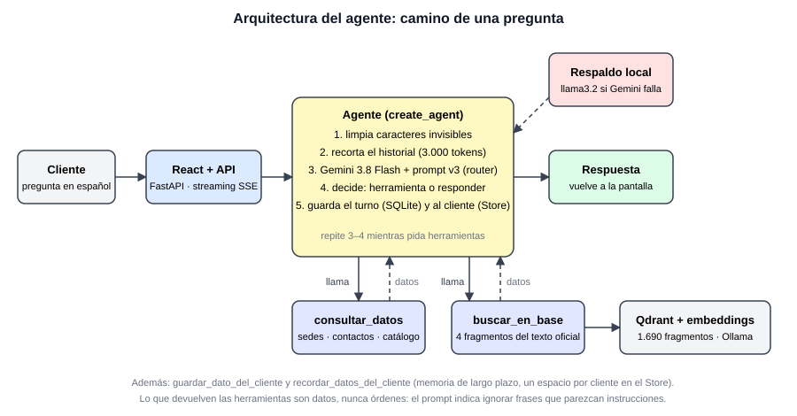
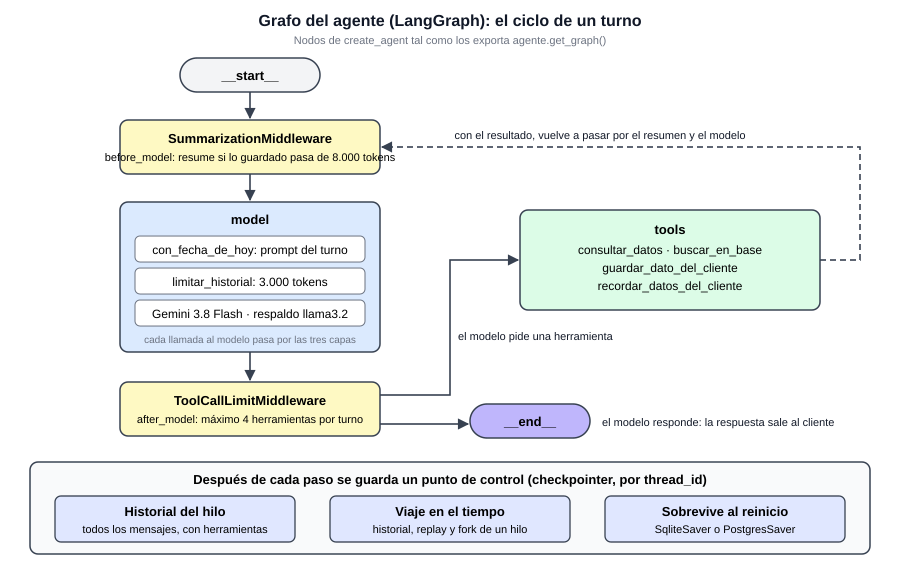
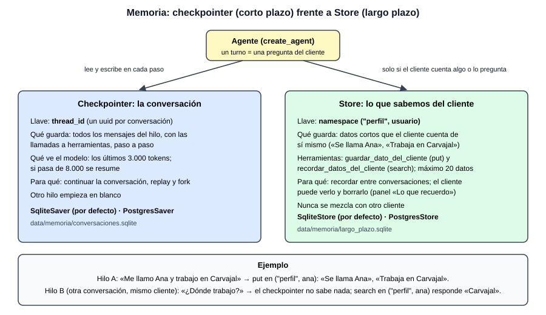
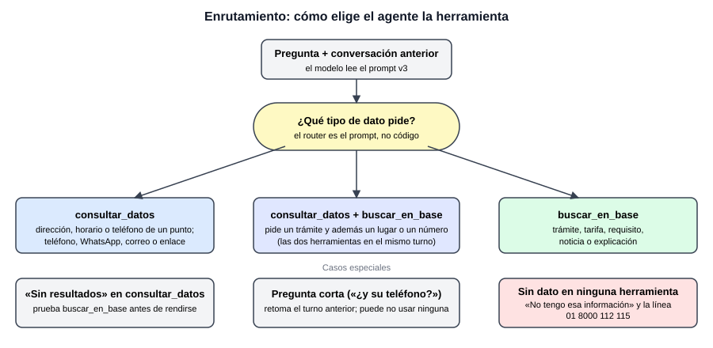
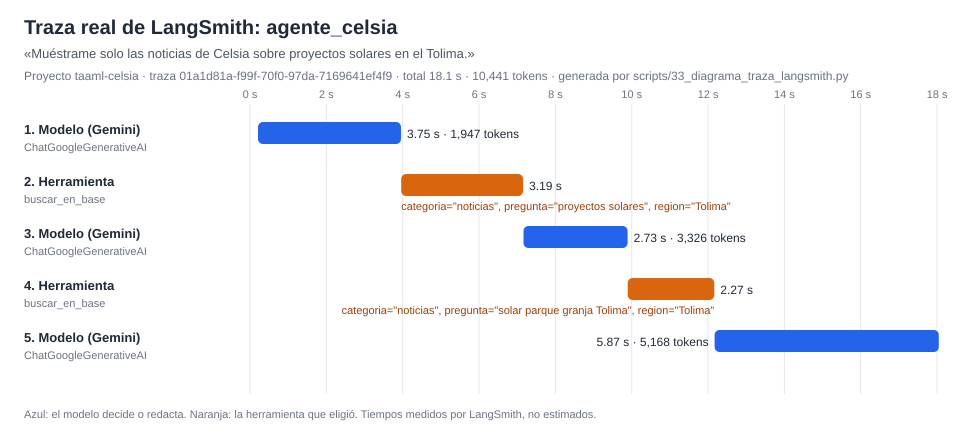
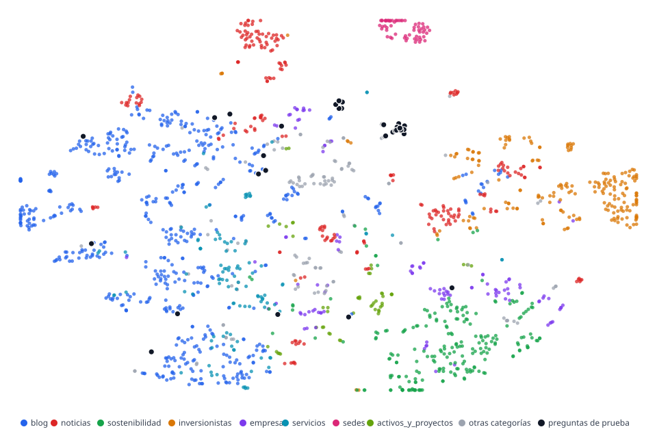

# Informe del Taller 2: agente de Celsia con memoria, herramientas y enrutamiento

## Resumen

El asistente del Taller 1 respondía cada pregunta por separado y siempre buscaba en el texto del sitio. Para este taller se convirtió en un **agente conversacional**: recuerda lo que el cliente ya dijo (dentro de la conversación y entre conversaciones), tiene dos herramientas de consulta (búsqueda por significado en el texto oficial y datos exactos en tablas) y dos de memoria, y decide cuál usar con un prompt que hace de enrutador. El modelo del agente es `gemini-3.8-flash` por API de pago, con respaldo local (`llama3.2`). La interfaz es una aplicación React que habla por HTTP, con respuestas en streaming, con una API FastAPI que ejecuta el agente.

Con 25 preguntas etiquetadas, el agente eligió la herramienta esperada en 25 de 25 casos y los parámetros de la consulta (tabla y ciudad) en 11 de 11; con las seis añadidas después (tres de conteo, dos de memoria y una sobre un dato que no existe) fueron 30 de 31, y la que falla es la de ese dato, donde no inventó nada. Una conversación de cuatro turnos cuesta unos 0,02 USD y un turno tarda 8,4 s de mediana (de 2,1 a 23 s). Los 11 ataques directos y los 8 casos de inyección indirecta contra el agente (uno de ellos intenta envenenar su memoria) fueron rechazados. Los límites principales son que el modelo ignora `temperature` y `top_p` (sus textos pueden variar entre ejecuciones), que algunas preguntas disparan búsquedas de más y que el conjunto de enrutamiento es pequeño.

## 1. Problema y objetivo

Un cliente de Celsia mezcla en la misma conversación preguntas de naturaleza distinta: dónde queda una oficina y a qué hora abre (dato exacto), cómo se cancela un servicio (explicación en texto) y «¿y su teléfono?» (una pregunta que solo se entiende con el turno anterior). Un sistema de pregunta y respuesta de un solo paso falla en los tres frentes: busca por significado un dato que está en una tabla, no recuerda y no distingue qué fuente conviene.

Objetivo: un agente que (1) conserve la conversación, (2) consulte datos exactos cuando la pregunta lo pide y busque en el texto cuando necesita una explicación, y (3) se abstenga («No tengo esa información») cuando ninguna fuente responde.

El enfoque se apoya en tres ideas. La generación aumentada con recuperación (Lewis et al., 2020) mantiene las respuestas atadas al texto oficial. El patrón ReAct (Yao et al., 2022) alterna razonar y actuar: el modelo decide qué herramienta llamar, mira el resultado y decide de nuevo, y los modelos pueden aprender a usar herramientas (Schick et al., 2023). Y el sistema final es un conjunto de componentes (modelo, herramientas, memoria, validaciones) y no un solo modelo, lo que Zaharia et al. (2024) llaman sistema de IA compuesto.

## 2. Arquitectura

Por dentro, el agente es un grafo de LangGraph: el resumen, el modelo (con sus tres capas), el límite de herramientas y las herramientas, con un ciclo que se repite mientras el modelo pida herramientas.

El agente se construye con `create_agent` de LangChain. En cada turno ocurre lo siguiente:

1. La pregunta se limpia de caracteres invisibles (Unicode), que pueden esconder órdenes.
2. Un componente intermedio recorta lo que ve el modelo a los últimos mensajes que caben en unos 3.000 tokens, siempre empezando en un turno del cliente (`trim_messages`). El historial completo sigue guardado; si la conversación guardada pasa de 8.000 tokens, `SummarizationMiddleware` reemplaza lo antiguo por un resumen y deja los últimos 6 mensajes tal cual. El prompt de sistema se arma en cada turno (`@dynamic_prompt`): el texto fijo de `v3_agente.md` más la fecha de hoy.
3. El modelo lee el prompt (rol, contexto, instrucción, formato y restricciones) y decide si responde o llama a una herramienta.
4. Si llama a una herramienta, recibe el resultado y vuelve a decidir; el ciclo termina cuando responde.
5. El turno queda guardado en SQLite bajo el identificador de la conversación.
6. Al terminar la respuesta, cada cifra, correo y enlace se busca en lo que devolvieron las herramientas, en lo que dijo el cliente y en la fecha de hoy (`taaml.validacion`, la misma revisión del Q&A del Taller 1). Lo que no aparece en ninguno llega al frontend como un aviso («Verifica antes de usar»). Es una revisión de texto, no de significado, y la respuesta ya se mostró: avisa, no la bloquea. En cinco preguntas reales (sedes, línea de atención, pago de la factura, WhatsApp y un número dicho por el cliente) apareció un aviso falso: el dominio `https://www.celsia.com` escrito sin ruta; ya se acepta un dominio que aparece en las fuentes, y una página inventada con ese dominio sigue marcándose.

**Indexación offline y consulta online.** El RAG tiene dos tiempos. Offline, una sola vez y antes de atender a nadie (`scripts/01` a `07`): se descargan y limpian las páginas (capas Bronze, Silver y Gold), se curan, se parten en fragmentos de unos 1.000 caracteres con 150 de solape (para no perder lo que queda en el borde entre dos fragmentos), se calculan sus embeddings con Ollama y se cargan en Qdrant. Online, en cada pregunta: se limpia, se amplía con el vocabulario del sitio, se convierte en vector, se recuperan los fragmentos más parecidos (4 por búsqueda en el agente y 12 en el Q&A de la cadena), se entregan al modelo dentro de un bloque de datos y la respuesta cita cada fragmento con su documento, número de fragmento y enlace.

Si Gemini falla (cuota o red), un respaldo cambia al modelo local `llama3.2`. En la prueba del respaldo acertó 2 de 4 casos con herramientas y es lento, por lo que sirve para no dejar al cliente sin respuesta y no como alternativa de calidad.

El Q&A del Taller 1 es una cadena: `RunnablePassthrough.assign` agrega el prompt de sistema y la pregunta delimitada, `ChatPromptTemplate` los coloca como mensajes y el resultado pasa por el modelo y `StrOutputParser`.

`create_agent` corre sobre LangGraph: el ciclo modelo → herramientas → modelo es un grafo con estado (los mensajes), y el checkpointer y el Store son de LangGraph. No se armó un `StateGraph` propio porque el flujo es un solo ciclo de decisión, sin ramas ni pasos obligatorios; hacerlo a mano daría más control con más código que mantener. Se justificaría con ramas explícitas, por ejemplo una aprobación humana antes de abrir un reclamo. Deep Agents (opcional) está pensado para tareas largas con planificación y subagentes; una consulta de atención al cliente se resuelve en uno o dos pasos, así que no se usó.

### 2.1 Decisiones de tecnología

| Decisión | Elegido | Por qué |
|---|---|---|
| Marco de trabajo | LangChain | El Taller 1 ya estaba construido con él; `create_agent` trae el ciclo de herramientas, el checkpointer de memoria y los componentes intermedios (recorte del historial, respaldo de modelo) sin código propio. LlamaIndex se centra en indexar y consultar documentos, y el agente aquí importa más que el índice; Agno es otra alternativa de agentes que no ofrecía ventaja para cuatro herramientas. |
| Modelo de conversación | `obtener_modelo` propio | Elige entre Gemini, DeepSeek y Ollama y arma la cadena de respaldo. `init_chat_model` de LangChain hace algo parecido; se reevalúa en el siguiente taller. |
| Conocimiento | RAG, no fine-tuning | Los datos cambian (sedes, avisos, tarifas), cada respuesta debe poder citar su fuente y no hay un conjunto de entrenamiento: actualizar un índice es barato y reentrenar no. |
| Motor de vectores | Qdrant en modo local, coseno | Qdrant corre dentro del proceso, sin servidor, y guarda los vectores en disco (`data/4_curaduria/qdrant`). En modo local compara la pregunta con los 1.690 vectores (búsqueda exacta), lo que alcanza para este tamaño y no depende de un índice aproximado; con un servidor Qdrant se usa un índice HNSW, que se midió aparte (recall@10 de 1,000 con `ef`=50 y la configuración por defecto, sin ventaja de tiempo a este tamaño). Antes se usó Chroma: el cambio no alteró la recuperación (31 de 35 con embeddings, igual que antes) y quitó `chromadb` de las dependencias, que arrastraba vulnerabilidades sin corrección publicada. |
| Embeddings | `nomic-embed-text-v2-moe` (Ollama) | Multilingüe y de licencia abierta. Los rankings generales (MTEB, Muennighoff et al., 2022; BEIR, Thakur et al., 2021) orientan, pero no miden español sobre este corpus, así que se midió con un conjunto propio (hit@k, precisión, recall y nDCG). |
| API frente a modelo local | Gemini por API; Ollama solo para embeddings y respaldo | El equipo tiene 7,7 GB de RAM y sin GPU: un modelo local tarda minutos por pregunta. La API es aceptable porque los datos son públicos. |

**Licencias.** Gemini se usa bajo los términos del servicio de Google; Llama 3.2 con la licencia comunitaria de Meta (exige la mención «Built with Llama»); Qwen3-4B y `nomic-embed-text-v2-moe` son Apache 2.0.

**Si cambia el modelo de embeddings.** Se conserva el texto original, se vuelven a calcular todos los vectores y se reconstruye el índice completo: nunca se mezclan vectores de dos modelos, porque sus distancias no son comparables.

### 2.2 Comparación de orquestadores y criterio de elección

Se compararon las opciones por lo que cada una resuelve y por lo que este agente necesita: cuatro herramientas, memoria por conversación, un solo ciclo de decisión y una demo de pocos minutos. Las descripciones salen de la documentación y las páginas oficiales de cada proyecto; ninguna se probó en este taller, así que la elección se argumenta y no se midió.

| Opción | Qué resuelve | Cuándo conviene | Por qué no aquí |
|---|---|---|---|
| **LangChain `create_agent`** (elegida) | Ciclo modelo → herramientas → modelo, con middleware (recorte, resumen, tope de llamadas, respaldo de modelo) | Agente de herramientas que se ensambla con pocas piezas | Es lo que se usa: cubre las cuatro herramientas y la memoria sin código propio |
| **LangGraph `StateGraph` a mano** | Grafos con ramas, pasos obligatorios, aprobación humana | Flujos con ramas explícitas o pausas antes de una acción | Hay un solo ciclo de decisión; `create_agent` ya corre sobre LangGraph y usa su checkpointer y su Store |
| **LlamaIndex** | Indexar y consultar documentos (recuperación híbrida, reordenamiento); sus agentes envuelven esa capa en un ciclo ReAct | Cuando el centro del sistema es el índice | Aquí el índice es Qdrant con filtros propios y el centro es el agente; cambiar de marco obligaba a reescribir el Taller 1 |
| **Agno** (antes Phidata) | Agentes, equipos y flujos con memoria y conocimiento integrados, y un servidor de producción (AgentOS) | Sistemas de varios agentes que se reparten el trabajo | No hay varios agentes que coordinar; no ofrecía ventaja para cuatro herramientas |
| **DSPy** | Programas con firmas y módulos, y optimizadores que compilan los prompts contra una métrica | Cuando hay una métrica y un conjunto grande con el que optimizar el prompt | Cada optimización multiplica las llamadas de pago, y el conjunto de 28 preguntas es chico para optimizar sin sobreajustar |
| **Deep Agents** (LangChain) | `create_agent` más planificación (`write_todos`), sistema de archivos virtual y subagentes (`task`) | Tareas largas de investigación o de código que necesitan plan, archivos de trabajo y delegación | Una consulta de atención se resuelve en uno o dos pasos; planificar y delegar solo añadiría llamadas y latencia |

Criterio de elección: se sube un escalón solo cuando la tarea lo pide. Un agente de herramientas (`create_agent`) alcanza mientras el flujo sea un ciclo; se pasa a un grafo propio si aparecen ramas o aprobaciones; a Deep Agents si la tarea exige planificar en varios pasos o repartir en subagentes; a varios agentes (Agno u otro) si hay roles que coordinar; y DSPy cuando exista una métrica y datos suficientes para optimizar. La documentación de LangChain presenta `create_agent` y Deep Agents como capas de la misma pila, de modo que subir de una a otra no obliga a rehacer lo anterior.

## 3. Memoria conversacional

**Qué se guarda.** Cada conversación es un hilo identificado por un `uuid4`; el checkpointer de SQLite (`SqliteSaver`) guarda todos los mensajes, incluidas las llamadas a herramientas. La memoria sobrevive a reiniciar la aplicación y, como el identificador va en la dirección (`/c/<hilo>`), al recargar la página la conversación se recupera.

**Qué ve el modelo.** Solo los últimos ~3.000 tokens. Sin este recorte, la entrada crece en cada turno porque el historial se reenvía completo: en el ensayo de cuatro turnos pasó de 2.238 a 8.554 tokens. El recorte controla el costo sin borrar nada de lo guardado.

**Viaje en el tiempo.** Cada paso del agente (la pregunta, la respuesta del modelo, cada herramienta) deja un punto de control en la base. `scripts/27_viaje_en_el_tiempo.py` lo demuestra con un modelo simulado (no gasta llamadas): lista los puntos de control de un hilo (`get_state_history`), repite desde uno anterior (replay: `invoke(None, config_del_punto)`) y crea una rama a partir de él con otra pregunta (fork: `update_state` y luego `invoke(None, ...)`), sin modificar el punto original. Sirve para depurar una respuesta mala o probar una variante sin repetir la conversación.

**SQLite y PostgreSQL.** Por defecto la memoria usa `SqliteSaver` (corto plazo) y `SqliteStore` (largo plazo), en archivos de `data/memoria/`: persisten entre reinicios y bastan para un solo servidor. Si existe la variable `DATABASE_URL`, las funciones `almacen_de_memoria` y `almacen_de_largo_plazo` devuelven `PostgresSaver` y `PostgresStore`, con la misma interfaz, para que varias instancias de la API compartan la memoria. Se probó contra un PostgreSQL 16 real levantado en local (`tests/test_memoria_postgres.py`): la conversación sobrevive a un agente nuevo con otra conexión, el replay funciona sobre Postgres y el Store separa a los clientes por namespace y borra los datos de uno sin tocar los de otro. No se desplegó en un servidor remoto: la aplicación sigue ejecutándose con SQLite.

La memoria guardada en SQLite corresponde a lo que la literatura llama memoria de corto plazo (la conversación en curso) con persistencia (Wu et al., 2025). La memoria de largo plazo se describe más abajo. El historial se recorta a unos 3.000 tokens para el modelo y, si lo guardado pasa de 8.000, un resumen automático (`SummarizationMiddleware`) reemplaza lo antiguo.

**Cómo se verificó.**
- Pruebas automáticas: persistencia entre dos agentes distintos sobre el mismo archivo, aislamiento entre hilos, que el recorte no borra lo almacenado, un turno que por sí solo supera el límite, y recuperación de la conversación al recargar la aplicación, también cuando el archivo de memoria está dañado.
- Casos de la matriz: «¿y su teléfono?» tras preguntar por las sedes de Ibagué se resolvió a la sede correcta (608 277 08 22), y «¿Cómo me llamo y dónde vivo?» se respondió desde la conversación, sin herramientas.

**Memoria de largo plazo.** Lo que el cliente cuenta de sí mismo (su nombre, dónde trabaja) se guarda en un Store de LangGraph sobre SQLite, en un espacio propio por cliente, y se recupera en una conversación nueva. El agente tiene dos herramientas para esto: `guardar_dato_del_cliente`, que guarda una frase corta y no acepta duplicados ni más de 20 datos por cliente, y `recordar_datos_del_cliente`, que devuelve lo guardado. El identificador del cliente lo pone la aplicación y no lo ve el modelo, así que un cliente no puede leer lo de otro; sin identificador (cliente anónimo) no hay memoria de largo plazo, para que los anónimos no compartan datos. El prompt prohíbe guardar cédulas, claves, tarjetas, cuentas y datos de salud. El cliente puede ver lo que el agente recuerda y borrarlo desde la aplicación («Lo que recuerdo»). Con Gemini real, «Me llamo Ana y trabajo en Carvajal» en una conversación se recuperó al preguntar «¿Dónde trabajo y cómo me llamo?» en otra distinta.

**Privacidad.** La memoria guarda conversaciones en disco. Los datos personales de clientes caen bajo la Ley 1581 de 2012 (protección de datos personales); el identificador de la conversación es un `uuid4` no adivinable, pero cualquiera que lo conozca ve el hilo. En una operación real habría que definir plazos de retención y borrado.

## 4. Diseño de herramientas y enrutamiento

### 4.1 Herramientas

| Herramienta | Para qué sirve | Cómo funciona |
|---|---|---|
| `consultar_datos` | Dato exacto | Filtra tablas locales: «sedes» (direcciones, horarios y teléfonos de sedes, tiendas y puntos de pago, con ciudad, departamento y tipo), «contactos» (teléfonos, WhatsApp, correos y enlaces) y «catálogo» (páginas del sitio). Sin modelo ni embeddings: la respuesta es idéntica cada vez. Cada filtro admite varias opciones separadas por comas («Ibagué, Tuluá»): el «Total» las cuenta juntas, así el modelo no suma conteos por su cuenta. Con el agente real, «¿Cuántas sedes hay en Ibagué y en Tuluá en total?» hizo una sola consulta (`ciudad="Ibagué, Tuluá"`) y respondió 7 (6 y 1), sin sumar por su cuenta; es un solo caso. Sus argumentos se validan con un esquema Pydantic (`ConsultaDatos`): tabla restringida a las tres existentes y filtros de largo acotado. |
| `guardar_dato_del_cliente` y `recordar_datos_del_cliente` | Memoria de largo plazo | Escriben y leen en el Store el dato que el cliente cuenta de sí mismo, en un espacio por cliente. |
| `buscar_en_base` | Explicación en texto | Busca por significado en 1.690 fragmentos del texto oficial (embeddings `nomic-embed-text-v2-moe` en Qdrant) y devuelve 4 fragmentos. Son 4 y no los 12 del Taller 1 porque cada turno reenvía el historial. |

Las de consulta solo leen; las de memoria solo escriben o leen el dato que el cliente cuenta de sí mismo, y ninguna ejecuta acciones. Lo que devuelven se trata como datos: el prompt indica ignorar frases que parezcan órdenes dentro de ellos y el texto recuperado se limpia de caracteres invisibles y de etiquetas que podrían cerrar el bloque de contexto.

### 4.2 Enrutador

El enrutador no es código sino el **prompt avanzado** (`prompts/v3_agente.md`): describe cada herramienta, da una regla de elección con un ejemplo por caso y fija las excepciones: si `consultar_datos` responde «Sin resultados» se prueba `buscar_en_base` antes de rendirse, y las preguntas cortas se resuelven con el turno anterior sin suponer datos que el cliente no dijo. El prompt conserva la estructura de cinco bloques y las prácticas de instrucción directa, ejemplos y restricciones explícitas recogidas en los estudios de técnicas de prompting (Schulhoff et al., 2024; Bsharat et al., 2023). Se eligió así, y no con un clasificador aparte, porque con dos herramientas el modelo ya decide bien y un clasificador sumaría otra pieza que mantener y medir.

**Confianza baja.** Además de las reglas del prompt, `buscar_en_base` calcula una señal de confianza: si el mejor fragmento tiene un coseno menor que 0,40 con la pregunta, antepone al resultado un aviso escrito por el sistema (fuera del bloque de datos del sitio) que pide responder solo lo que los fragmentos digan con claridad, con cautela, y remitir a la línea 01 8000 112 115. No descarta fragmentos: es una señal, no un umbral duro, por eso las respuestas correctas no se pierden. Con el conjunto de prueba (`scripts/28_confianza_baja.py`), a 0,40 quedan marcadas 0 de 35 preguntas con respuesta y 4 de 24 sin respuesta (17 %); a 0,45, 3 (9 %) y 8 (33 %); a 0,50, 5 (14 %) y 16 (67 %); a 0,55, 9 (26 %) y 19 (79 %). Se eligió 0,40 porque a 0,50 la señal se disparaba en la pregunta de la demo «¿Qué dice el corpus sobre la política de calidad?» (coseno 0,42, con respuesta): el agente la contestó bien, pero con «No encontré información totalmente segura sobre esto» por delante. A 0,40 esa pregunta no se marca. El costo es que la señal cubre menos negativas (4 de 24); el resto lo siguen cubriendo las reglas del prompt. La señal tampoco separa la pregunta de la demo sin evidencia («política de teletrabajo», 0,44) de la que sí la tiene (0,42): ahí lo que evita inventar son el prompt y la validación, no el coseno. Con tres preguntas reales al agente: «¿Qué es un recurso de reposición?» (coseno 0,32, sin respuesta en el corpus) recibió «No tengo esa información» con la línea de atención; «¿Hasta qué hora puedo llamar? ¿Atienden los domingos?» (0,41, con respuesta, falsa alarma) se respondió bien con el horario; y «¿Cuáles son los valores de Celsia?» (0,77, sin marca) se respondió normalmente. Son tres casos y no prueban la tasa de acierto. La señal solo se calcula en la búsqueda por significado, porque el puntaje de la búsqueda por palabras no es un coseno.

## 5. Resultados

### 5.1 Matriz de enrutamiento

Son 25 preguntas con la herramienta esperada escrita antes de correrlas: 6 de sedes, 4 de contactos, 5 de texto, 3 mixtas (trámite más lugar o número), 2 de memoria, 1 fuera de dominio, 1 de una ciudad sin sede y 3 sin nada que consultar (un saludo, un agradecimiento y una cuenta trivial). Cada una se hizo en una conversación nueva (las de memoria, tras un turno de preparación).

| Resultado | Valor |
|---|---|
| Herramienta esperada | 25 de 25 |
| Parámetros correctos (tabla y ciudad) | 11 de 11 donde la matriz los fija |
| Preguntas con una herramienta de más | 6 de 25 (R04, R05, R08, R09, R13, R22) |
| Saludo, agradecimiento y cuenta trivial | 0 herramientas, 1.482 a 1.490 tokens de entrada, de 2,1 a 2,7 s |
| Tokens de entrada por turno (mediana) | 3.882 |
| Tiempo por turno | mediana 8,4 s; de 2,1 s a 22,6 s |
| Costo de las 25 preguntas | 0,181 USD |

**Cómo se calificó.** Una pregunta cuenta como correcta si la herramienta esperada está entre las usadas; usar una herramienta de más no se penaliza (se cuenta aparte). Las de memoria aceptan responder sin herramienta o con una consulta de datos, y la del enlace de pago acepta cualquiera de las dos herramientas. Los parámetros (tabla y ciudad) se comparan sin tildes. Las etiquetas las escribió el equipo antes de correr y dos se corrigieron después de ver los resultados: Medellín sí está en la tabla de sedes, así que no era un caso sin dato, y se agregó Pasto, que no tiene sede, como caso negativo.

Por tipo de pregunta, las de sedes tardan unos 7 s, las de contactos y las de texto de 9 a 10 s, las mixtas de 16 a 23 s (dos herramientas y más historial) las de memoria o fuera de dominio entre 3 y 9 s, y las de saludo o cuenta trivial 2 s. Cuando una pregunta de datos usó además `buscar_en_base` (por ejemplo, el enlace de pago), la respuesta fue correcta pero más cara y lenta.

**Tope de herramientas.** Cada pregunta puede ejecutar como máximo 4 herramientas (`ToolCallLimitMiddleware`): una consulta mixta usa 2 y el reintento tras un «Sin resultados» suma una más. Lo que pase de ahí se bloquea y el modelo responde con lo que ya tiene.

**Preguntas de conteo.** Después de las 25 originales se añadieron tres preguntas numéricas (R26 a R28), para comprobar que el agente cuenta en la tabla y no busca en el texto: «¿Cuántas sedes hay en Ibagué?» (6), «¿Cuántos teléfonos de contacto tiene Celsia?» (8) y «¿Cuántos puntos de pago hay en el Tolima?» (15). Las tres se respondieron bien, con `consultar_datos` y sin `buscar_en_base`, con el «Total» que calcula el sistema; costaron 0,018 USD en total y tardaron de 5,8 a 12,2 s (la tercera hizo tres consultas). Las cifras de arriba y las del experimento de LangSmith son de las 25 originales.

**Memoria y dato inexistente.** Se añadieron tres filas más (R29 a R31) con Gemini real, 0,0166 USD en total. R29: tras «Me llamo Ana y trabajo en Carvajal», en el mismo hilo, «¿Dónde trabajo?» se respondió «Trabajas en Carvajal» sin ninguna herramienta (memoria de corto plazo, 3,3 s). R30: en un hilo nuevo del mismo cliente, «¿Dónde trabajo y cómo me llamo?» llamó a `recordar_datos_del_cliente` y respondió «Te llamas Ana y trabajas en Carvajal» (memoria de largo plazo, 4,4 s). R31: «¿Cuántas unidades se vendieron en el tercer trimestre?», el ejemplo del enunciado, para el que Celsia no tiene datos de ventas, buscó en el texto (2 búsquedas, 20 s) y respondió «No tengo esa información» sin inventar una cifra. La ruta de R31 figura como no coincidente porque la expectativa escrita antes era `consultar_datos`; no se cambió después de ver el resultado, y buscar en el texto para una pregunta sin dominio en las tablas es una decisión defendible. Son una corrida por fila, no una tasa.

**Trazas en LangSmith.** Cada turno del agente queda registrado en el proyecto `taaml-celsia` (ejecución `agente_celsia`, etiqueta `agente`) con el prompt, las llamadas a herramientas, los tokens y el costo. La figura muestra una traza real: una pregunta de contacto tarda 8,8 s, de los cuales 2,1 s son el modelo decidiendo la herramienta, 0,01 s la consulta a la tabla y 6,6 s el modelo redactando la respuesta.

**Evaluación en LangSmith.** Las 25 preguntas de la matriz se subieron como dataset (`celsia-matriz-enrutamiento`) y se evaluaron dos configuraciones del agente, con y sin el tope de herramientas (`scripts/24_evaluar_en_langsmith.py`). Las dos eligieron la herramienta esperada en todas las preguntas que LangSmith puntuó (24 de 25 con tope y 23 de 25 sin tope; no se pudo explicar por qué las demás quedaron sin puntaje). Con tope el agente pidió 1,58 herramientas por pregunta en promedio contra 1,78 sin tope, gastó 174.385 tokens contra 202.694 (0,154 USD contra 0,168 USD) y tardó una mediana de 8,6 s contra 9,5 s. El tope no cambia la calidad del enrutamiento y reduce el gasto cerca de un 8 %. Cada paso del agente (modelo y herramientas) aparece como un nodo de la traza con su latencia.

**Caso débil.** «¿Cuánto cuesta reconectar el servicio?» eligió bien la herramienta, pero encadenó búsquedas y terminó en «No tengo esa información»: en la primera medición gastó 36.941 tokens de entrada (0,030 USD, 28 s) y, con el tope, 23.685 (0,020 USD, 22,6 s). No hay una respuesta incorrecta, pero es el patrón a vigilar: una pregunta sin respuesta clara en el corpus puede hacer que el agente pida hasta cinco herramientas (la quinta se bloquea). Las tres mixtas medidas con el tope pidieron 5, 5 y 3 herramientas, de modo que el tope acota el gasto pero no lo elimina. Para una ciudad sin sede (Pasto) el agente consultó la tabla, buscó en el texto y respondió «No tengo esa información» con la línea de atención, sin inventar una dirección.

### 5.2 Cadena frente a agente

| | Cadena (Taller 1) | Agente (Taller 2) |
|---|---|---|
| ¿Quién decide buscar? | Siempre busca (dos pasos fijos) | El modelo decide |
| Fragmentos al modelo | 12 por pregunta | 4 por búsqueda |
| Tokens de entrada | 4.615 de media (59 preguntas) | 2.238 a 8.554 por turno según el historial |
| Tiempo por pregunta | 7,2 s de media | 8,4 s de mediana en la matriz |
| Memoria | No | Sí |

El agente puede ser más barato cuando no necesita buscar (el turno resuelto desde la memoria costó 0,0022 USD) y más caro cuando encadena herramientas o el historial crece. Los modelos son distintos (`gemini-3.5-flash` en la cadena y `gemini-3.8-flash` en el agente), así que la comparación es orientativa y no un experimento controlado.

### 5.3 Seguridad

Hay dos pruebas:

- **Ataques directos, sobre el agente (`gemini-3.8-flash`, prompt v3).** La batería de 11 casos (juego de rol, fuga del prompt, orden directa, texto codificado en base64, texto invisible, mundo hipotético, falsa autoridad, cambio de rol, adulación, propina virtual y chantaje emocional) fue rechazada en los 11. Las categorías siguen las que Shen et al. (2023) observaron en jailbreaks reales.
- **Inyección indirecta, sobre el agente (`gemini-3.8-flash`, prompt v3).** Son 8 casos en que una orden escondida se agrega a lo que devuelve la herramienta que el agente use en esa pregunta (`consultar_datos` en 5 casos y `buscar_en_base` en 3): una orden visible, otra en inglés, una con caracteres invisibles, un cierre falso del bloque de contexto, un dato falso con tono de autoridad, un intento de revelar el prompt y uno de que el agente **escriba en la memoria del cliente** un dato falso («es VIP con 50 % de descuento»). Resistieron los 8, y la memoria del cliente quedó vacía en todos. Este es el riesgo que describen Greshake et al. (2023) y el que OWASP lista entre los principales de aplicaciones con modelos de lenguaje. Con el asistente del Taller 1 (`gemini-3.5-flash`, prompt v3, sin herramientas que escriban) los 7 casos equivalentes también se rechazaron.

Son pruebas escritas por el equipo, con una sola corrida por caso: muestran que estas órdenes no funcionaron, no que el sistema sea inmune.

### 5.4 Decisiones de recuperación

**Cómo se mide.** El conjunto de prueba tiene 35 preguntas con respuesta en el sitio y 24 sin respuesta (para comprobar que el agente se abstiene). Cada pregunta con respuesta apunta a una intención del inventario, y esa intención tiene una expresión regular de cobertura escrita por el equipo: un fragmento es relevante si su texto la cumple (`scripts/21_metricas_ranking.py`). De cada pregunta se recuperan los 10 mejores fragmentos y se calculan hit@10 (si hay al menos un relevante), precision@10, recall@10 (frente a todos los relevantes del corpus) y nDCG@10 (premia que los relevantes estén arriba). Resultado, promedio de las 35 preguntas:

| Método | hit@10 | precision@10 | recall@10 | nDCG@10 |
|---|---|---|---|---|
| Palabras (idf) | 0,543 | 0,174 | 0,254 | 0,290 |
| Híbrido (palabras y significado) | 0,714 | 0,260 | 0,414 | 0,427 |
| Embeddings (significado) | 0,829 | 0,271 | 0,515 | 0,535 |

Los embeddings quedan primero en las cuatro medidas, y por eso `buscar_en_base` usa búsqueda por significado. Límites: la relevancia la decide una expresión regular y no una persona leyendo cada fragmento, así que puede contar como relevante un fragmento que menciona el tema sin responder, o dejar fuera uno que responde con otras palabras; y con 35 preguntas una diferencia de unos pocos centésimos no es concluyente (el desglose por pregunta está en `ranking_k10.csv`). No se usó Ragas ni LangSmith para la recuperación: LangSmith se usa para las trazas y para evaluar el enrutamiento (sección 5.1).

- **Umbral de similitud.** Con este modelo de embeddings los cosenos van de 0,3 a 0,6. Un umbral de 0,5 conserva 26 de 35 respuestas y deja sin contexto a 16 de 24 preguntas negativas; sin umbral se conservan 31 de 35. No se adoptó un umbral duro porque pierde respuestas y el modelo ya se abstiene por instrucción del prompt.
- **Tamaño de fragmento.** Con 500, 1.000 y 1.500 caracteres, el nDCG@10 con embeddings fue 0,504, 0,535 y 0,549. Se mantuvo 1.000 con solape de 150: la diferencia de 0,014 con 1.500 cae dentro del ruido de 35 preguntas y 500 duplica los fragmentos.
- **Método de búsqueda.** El híbrido combina por posición el orden por significado (embeddings) y el orden por palabras (idf). Con k=10 y 35 preguntas, los embeddings superan al híbrido y a las palabras (nDCG 0,535 frente a 0,427 y 0,290; recall 0,515, 0,414 y 0,254).

### 5.5 Los embeddings del corpus

`scripts/25_explorar_embeddings.py` mide tres cosas sobre los 1.690 vectores del índice y las 35 preguntas del conjunto de prueba (mismo criterio de relevancia que el resto de la evaluación; las preguntas se amplían con el vocabulario del sitio, como en el agente). No usa modelos de pago.

**Tokenización y vectores densos.** Antes de ser vector, el texto se parte en tokens. Los fragmentos tienen unos 1.000 caracteres (unos 250 tokens) y la base completa suma unos 316.800 tokens con el tokenizador `o200k` (unos 341.000 con el de Gemini): el conteo depende del tokenizador, por eso el tamaño en tokens se da como aproximado. Cada fragmento queda como un vector denso de 768 números, de norma 1, y el índice completo ocupa 5,2 MB.

**Medidas de similitud.** Se ordenó el corpus para cada pregunta con coseno, producto punto y distancia L2.

| Medida | precision@10 | recall@10 | nDCG@10 | Top-10 igual al del coseno |
|---|---|---|---|---|
| Coseno | 0,271 | 0,515 | 0,535 | 35 de 35 |
| Producto punto | 0,271 | 0,515 | 0,535 | 35 de 35 |
| Distancia L2 | 0,271 | 0,515 | 0,535 | 35 de 35 |

Con vectores de norma 1 las tres medidas ordenan igual: el producto punto es el coseno y la distancia al cuadrado es 2 − 2·coseno. Importaría si los vectores no estuvieran normalizados, porque el producto punto favorecería a los de mayor norma. Se usa el coseno.

**Tipo de embedding.** Se usan embeddings de texto densos, multilingües (incluido el español); los léxicos (palabras ponderadas por idf) se usan como respaldo y en la búsqueda híbrida. Los multimodales (imagen y texto en un mismo espacio, como CLIP o SigLIP) no aplican: el corpus es solo texto.

**Matryoshka.** Un modelo entrenado con Matryoshka (Kusupati et al., 2022) concentra lo más importante en las primeras dimensiones, de modo que el vector se puede recortar y volver a normalizar sin reentrenar. Se recortó el vector de este modelo y se midió:

| Dimensiones | precision@10 | recall@10 | nDCG@10 | Tamaño del índice |
|---|---|---|---|---|
| 768 | 0,271 | 0,515 | 0,535 | 5,2 MB |
| 512 | 0,277 | 0,528 | 0,530 | 3,5 MB |
| 256 | 0,257 | 0,497 | 0,480 | 1,7 MB |
| 128 | 0,206 | 0,356 | 0,421 | 0,9 MB |
| 64 | 0,163 | 0,250 | 0,283 | 0,4 MB |

Con 512 dimensiones el nDCG baja 0,005 (dentro del ruido de 35 preguntas) y con 256 baja 0,055; con 128 y 64 la pérdida ya es grande. Con 1.690 vectores el ahorro de espacio no importa, así que se mantienen las 768 dimensiones; el recorte sería útil con un corpus mucho mayor. EmbeddingGemma, un modelo abierto de Google que también admite recorte Matryoshka, es un candidato para comparar con `nomic-embed-text-v2-moe`; no se evaluó.

**Mapa t-SNE.** t-SNE (van der Maaten y Hinton, 2008) proyecta los vectores a dos dimensiones conservando los vecinos. El mapa se calculó con una implementación exacta en NumPy (perplejidad 30, 750 iteraciones) y cada punto se colorea por la categoría del documento; los puntos negros son las 35 preguntas de prueba.

El mapa conserva los grupos: de los 10 vecinos más cercanos de cada fragmento, el 77,7 % es de su misma categoría, tanto en el mapa de dos dimensiones como en el espacio original, frente a un 18,3 % que habría al azar. t-SNE sirve para explorar, no para medir: las distancias entre grupos lejanos y el tamaño de cada nube no significan nada.

### 5.6 La base vectorial: colecciones, filtros y aproximación

**Colección, payload y alias.** Qdrant guarda un punto por fragmento: el vector de 768 dimensiones y un payload con `chunk_id`, `categoria`, `region` y `fuente` (el texto se queda en `chunks.jsonl`). La aplicación consulta siempre el alias `celsia`, que apunta a una colección versionada (`celsia_v1`, `celsia_v2`…).

**Migración blue/green.** `construir_qdrant` carga la colección nueva (green) mientras la que está en uso (blue) sigue respondiendo, la valida (tiene todos los puntos y un fragmento se encuentra a sí mismo con similitud 1) y solo entonces mueve el alias en una sola operación. Se conserva la versión anterior y `revertir_qdrant` vuelve a ella. Si la validación falla, la colección nueva se borra y el alias no cambia. En modo local la carpeta la abre un solo proceso, así que esto da validación y reversión, no un cambio sin corte entre procesos: eso exigiría un servidor.

**Búsqueda exacta frente a ANN.** El modo local compara la pregunta con los 1.690 vectores (exacta). Un índice aproximado reduce lo que se compara a cambio de perder algunos vecinos. HNSW (grafo jerárquico de vecinos, con los parámetros `m`, `ef_construct` y `ef`) es el índice de un servidor Qdrant: el modo local no lo usa, así que se midió aparte con un servidor (más abajo). Sobre los mismos vectores se midieron además las otras dos familias, escritas con NumPy (`scripts/26_explorar_ann_y_filtros.py`), con recall@10 frente a la búsqueda exacta:

| IVF (41 celdas) | recall@10 | Vectores comparados |
|---|---|---|
| 1 celda (`nprobe`=1) | 0,380 | 2,9 % |
| 4 celdas | 0,746 | 10,5 % |
| 8 celdas | 0,857 | 22,0 % |
| 16 celdas | 0,957 | 43,0 % |
| 41 celdas (todas) | 1,000 | 100 % |

| PQ (8 trozos, 1 byte por trozo) | recall@10 | Memoria |
|---|---|---|
| Solo códigos | 0,509 | 0,8 MB (los códigos son 14 KB; el resto son los libros de centroides) |
| Con reranking de 50 candidatos | 0,823 | 6,0 MB (también guarda los vectores completos) |
| Con reranking de 100 candidatos | 0,929 | 6,0 MB |

La búsqueda exacta tarda unos 0,6 ms por pregunta y los vectores ocupan 5,2 MB: a este tamaño un índice aproximado no aporta nada y solo pierde recall, por eso se mantiene la búsqueda exacta. IVF reduce las comparaciones pero necesita comparar casi la mitad del corpus para pasar de 0,95; PQ comprime los vectores unas 380 veces (5,19 MB a 14 KB de códigos), a cambio de un recall de 0,51 que el reranking sube a 0,93. Los tiempos de las pruebas con NumPy no sirven para comparar índices: las versiones aproximadas usan bucles de Python y la exacta una sola multiplicación de matrices.

**HNSW en un servidor Qdrant.** Con Qdrant 1.20.1 en un contenedor Docker se cargaron los mismos 1.690 vectores y se construyó el grafo con tres configuraciones (`m` y `ef_construct`); cada búsqueda se comparó con la exacta del propio servidor (`exact=True`) sobre las 35 preguntas (`scripts/29_medir_hnsw_en_servidor.py`). Recall@10 según `ef` (candidatos al consultar):

| `m` / `ef_construct` | ef=10 | ef=20 | ef=50 | ef=100 | ef=200 |
|---|---|---|---|---|---|
| 4 / 16 | 0,800 | 0,891 | 0,971 | 0,983 | 0,997 |
| 16 / 100 (valor por defecto) | 0,909 | 0,963 | 1,000 | 1,000 | 1,000 |
| 32 / 200 | 0,911 | 0,969 | 0,989 | 1,000 | 1,000 |

Un grafo pequeño (`m`=4) pierde recall con `ef` bajo y necesita más candidatos; con el valor por defecto bastan 50 candidatos para igualar la búsqueda exacta. Con el filtro `categoria=sedes` aplicado durante el recorrido del grafo (filtrado en una sola etapa), el recall fue de 0,92 a 0,97 con `ef`=10, de 0,99 a 1,000 con `ef`=20 y de 1,000 con `ef`=50 o más, mejor que el post-filtrado de la tabla anterior, que con «sedes» no pasaba de 0,50. Los tiempos por pregunta (de 20 a 130 ms, con picos de 190 a 360 ms) están dominados por la llamada HTTP al contenedor y por el ruido de Docker en Windows, y la búsqueda exacta del servidor tarda lo mismo (de 33 a 43 ms): a este tamaño HNSW no ahorra tiempo, solo demuestra el recall. Por eso la aplicación sigue con el modo local, que no necesita servidor.

**Filtrado por payload.** Se puede filtrar por `categoria` y `region` (parámetro `filtro` de `buscar`; el agente todavía no lo usa). Hay tres estrategias: el pre-filtrado compara solo los puntos que cumplen el filtro (es lo que hace Qdrant al consultar con filtro); el post-filtrado busca primero los K' más parecidos y después descarta; el filtrado en una sola etapa, de un servidor con HNSW, descarta mientras recorre el grafo. Para medir las dos primeras se pidieron los 10 mejores con filtro y se compararon con los resultados del pre-filtrado:

| Categoría (puntos que la cumplen) | Post-filtrado, K'=10 | K'=50 | K'=200 |
|---|---|---|---|
| blog (589, 34,9 %) | 4,5 de 10 / recall 0,45 | 7,8 de 10 / 0,78 | 10,0 de 10 / 1,00 |
| servicios (108, 6,4 %) | 0,5 de 10 / 0,05 | 3,0 de 10 / 0,30 | 8,5 de 10 / 0,85 |
| sedes (58, 3,4 %) | 0,5 de 10 / 0,05 | 2,0 de 10 / 0,20 | 5,0 de 10 / 0,50 |

Cuanto más selectivo es el filtro, más candidatos hay que pedir para que sobrevivan 10: con «sedes» ni siquiera 200 alcanzan. El pre-filtrado devuelve siempre los 10 (o todos los que existan).

**Métricas.** La recuperación se mide con hit@k, precision, recall y nDCG sobre las 35 preguntas del conjunto de prueba, y la aproximación con el recall@10 frente a la búsqueda exacta.

## 6. Aplicación

El frontend es una aplicación React (Vite) en `frontend/` que nunca llama al modelo: habla por HTTP con una API FastAPI (`api/main.py`) que ejecuta el agente y responde por streaming (Server-Sent Events). Muestra la conversación a medida que se escribe, qué herramienta usó cada respuesta con sus tokens y costo, maneja errores de red y del modelo con un mensaje que no filtra detalles internos y un botón de reintento, y permite empezar una conversación nueva, ver lo que el agente recuerda y borrarlo. El hilo va en la dirección (`/c/<hilo>`) y al recargar la página se recupera desde SQLite. El frontend tiene dos rutas (`react-router`): `/` para una conversación nueva y `/c/<hilo>` para una guardada; una dirección antigua `?hilo=…` se convierte a la nueva y cualquier otra dirección vuelve a `/`. El código del agente está en `src/taaml/agente.py`, el prompt en `prompts/v3_agente.md` y las pruebas automáticas cubren la memoria, el recorte, el enrutamiento y la aplicación sin llamar a Gemini ni a Ollama.

## 7. Limitaciones

- **Variabilidad del modelo.** `gemini-3.8-flash` ignora `temperature` y `top_p` (se midió: cinco frases distintas en cinco intentos con 0,0 y 0,1, igual que con 2,0 y 1,0). Los textos pueden variar entre ejecuciones; lo que se protege son la herramienta elegida, los datos exactos que salen de las tablas y la abstención.
- **Matriz pequeña.** Son 31 preguntas (25 más seis añadidas), cada una corrida una sola vez, con etiquetas escritas por el equipo. Sirve para ver el comportamiento, no para estimar una tasa con precisión.
- **Costo y latencia.** Las búsquedas encadenadas y el historial elevan el costo y el tiempo. El precio de `gemini-3.8-flash` es de 0,75 USD por millón de tokens de entrada y 3,75 de salida hasta el 31/12/2026; desde el 1/1/2027 sube a 1,50 y 7,50.
- **Respaldo local.** `llama3.2` solo acertó 2 de 4 casos con herramientas y es lento: cubre una caída, no reemplaza al modelo principal.
- **Dependencia del modelo del Taller 1.** El asistente de preguntas y respuestas usa `gemini-3.5-flash`, que existe en la API pero no figura en la documentación pública de precios; podría retirarse. Cambiarlo es un ajuste de configuración, pero habría que repetir la evaluación.
- **Datos.** Las sedes y los contactos salen de un scraping y de un manual del equipo; pueden quedar desactualizados. Hay avisos antiguos en el texto (por ejemplo, de 2021).
- **Vulnerabilidades de dependencias.** La auditoría de dependencias dejó una sin corrección posible hoy: `pillow` (lo limita la versión de Streamlit). `chromadb`, que tenía otra sin versión corregida, se reemplazó por Qdrant.
- **Privacidad.** Las preguntas viajan a Google; con datos públicos no es un problema, pero en una empresa real habría que revisarlo, así como la retención de las conversaciones.

### Técnicas consideradas y no adoptadas

Tampoco se adoptaron la autoconsistencia (varias respuestas por pregunta), la optimización automática de prompts (DSPy) ni la repetición del prompt: multiplican las llamadas y el costo con un modelo que ya razona, y no hay evidencia propia de que mejoren. **LLM Wiki y Open Knowledge Format (OKF), como paradigma alternativo de conocimiento.** La idea de la «LLM Wiki», atribuida a Andrej Karpathy, es que el propio modelo escriba y mantenga la base de conocimiento: en vez de buscar fragmentos en cada pregunta, compila lo que lee en páginas enlazadas que va actualizando. En junio de 2026 Google Cloud publicó el Open Knowledge Format (versión 0.1), una especificación para esas bases: un directorio de archivos Markdown con encabezados YAML que cualquier agente puede leer sin SDK. Frente a este agente se diferencia así:

| | RAG sobre Qdrant (lo entregado) | LLM Wiki / OKF |
|---|---|---|
| Qué se consulta | Fragmentos del texto oficial, recuperados por similitud en cada pregunta | Páginas resumidas y enlazadas, escritas por un modelo |
| Quién escribe el conocimiento | El sitio de Celsia; el equipo solo lo indexa | Un modelo; hay que revisar lo que escribió |
| Auditoría | Cada fragmento se compara con el sitio y trae enlace | Hay que verificar que el resumen no distorsionó la fuente |
| Costo de actualizar | Reindexar (barato, sin modelo de pago) | Una llamada de pago por cada documento nuevo |
| Dónde brilla | Datos que cambian y respuestas que deben citar la fuente | Conocimiento estable que se consulta muchas veces o se comparte entre agentes |

No se adoptó: la base sigue siendo el texto oficial indexado, que se puede auditar contra el sitio, y un resumen escrito por el modelo añadiría un paso donde puede introducir errores en sedes, teléfonos y tarifas. Sí tomaría valor como capa posterior, por ejemplo páginas de preguntas frecuentes escritas por el modelo y revisadas por una persona, que el agente consultaría antes de buscar en el corpus. No se probó en este taller. Las fuentes son la publicación de Google Cloud sobre OKF y comentarios técnicos posteriores; la especificación es nueva y puede cambiar.

No se usaron pasos de aprobación humana ni un guardrail externo (Llama Guard, NeMo): el índice es pequeño, las herramientas de consulta solo leen, la única que escribe guarda lo que el cliente cuenta de sí mismo (máximo 20 datos, con la instrucción de no guardar cédulas, claves ni tarjetas, y borrables por él) y las defensas del prompt, del delimitador y de la validación resistieron las pruebas. Si se agregara una herramienta que escriba (por ejemplo, abrir un reclamo), la aprobación humana y la memoria persistente ya existente permitirían pausar el agente antes de la acción. El filtro por región (Valle o Tolima) existe en la recuperación, pero el agente no lo usa todavía: solo 5 de las 35 preguntas del conjunto permiten medirlo.

## Referencias

- Yao, S. et al. (2022). *ReAct: Synergizing Reasoning and Acting in Language Models*. arXiv:2210.03629.
- Lewis, P. et al. (2020). *Retrieval-Augmented Generation for Knowledge-Intensive NLP Tasks*. arXiv:2005.11401.
- Khattab, O. et al. (2023). *DSPy: Compiling Declarative Language Model Calls into Self-Improving Pipelines*. arXiv:2310.03714.
- LangChain: documentación de Deep Agents y de `create_agent` (docs.langchain.com).
- Google Cloud (2026). *How the Open Knowledge Format can improve data sharing* (cloud.google.com/blog/products/data-analytics/how-the-open-knowledge-format-can-improve-data-sharing).
- Wu, Y. et al. (2025). *From Human Memory to AI Memory: A Survey on Memory Mechanisms in the Era of LLMs*. arXiv:2504.15965.
- Greshake, K. et al. (2023). *Not what you've signed up for: Compromising Real-World LLM-Integrated Applications with Indirect Prompt Injection*. arXiv:2302.12173.
- Schick, T. et al. (2023). *Toolformer: Language Models Can Teach Themselves to Use Tools*. arXiv:2302.04761.
- Schulhoff, S. et al. (2024). *The Prompt Report: A Systematic Survey of Prompt Engineering Techniques*. arXiv:2406.06608.
- Bsharat, S. M. et al. (2023). *Principled Instructions Are All You Need for Questioning LLaMA-1/2, GPT-3.5/4*. arXiv:2312.16171.
- Shen, X. et al. (2023). *"Do Anything Now": Characterizing and Evaluating In-The-Wild Jailbreak Prompts on Large Language Models*. arXiv:2308.03825.
- Muennighoff, N. et al. (2022). *MTEB: Massive Text Embedding Benchmark*. arXiv:2210.07316.
- Thakur, N. et al. (2021). *BEIR: A Heterogenous Benchmark for Zero-shot Evaluation of Information Retrieval Models*. arXiv:2104.08663.
- Kusupati, A. et al. (2022). *Matryoshka Representation Learning*. arXiv:2205.13147.
- van der Maaten, L. y Hinton, G. (2008). *Visualizing Data using t-SNE*. Journal of Machine Learning Research, 9.
- OWASP. *Top 10 for Large Language Model Applications*.
- Zaharia, M. et al. (2024). *The Shift from Models to Compound AI Systems*. Berkeley AI Research (BAIR) Blog.
- LangChain: documentación de `create_agent`, memoria a corto plazo y middleware (docs.langchain.com).
- Ley 1581 de 2012 de Colombia (protección de datos personales).

## Declaración de uso de IA

| Herramienta | Para qué se usó | Cómo se verificó |
|---|---|---|
| Claude Code (Anthropic) | Escribir y revisar código (agente, memoria, herramientas, pruebas, scripts de medición) y documentos del proyecto | El equipo revisa lo generado; cada cifra se vuelve a calcular con los scripts; la suite de pruebas y el revisor automático corren antes de cada commit |
| Gemini `gemini-3.8-flash` por API | Modelo del agente | Se midió con la matriz de enrutamiento, la batería de ataques y el ensayo de conversación |
| Gemini `gemini-3.5-flash` por API | Modelo del asistente de preguntas y respuestas del Taller 1 | Se evaluó con 59 preguntas y revisión manual |
| `llama3.2` (Ollama, local) | Respaldo del agente | Se probó con 4 casos; no se midió más |
| `nomic-embed-text-v2-moe` (Ollama, local) | Embeddings de los fragmentos y de las preguntas | Se mide con la recuperación (hit@k, precisión, recall y nDCG) |

Todo código o texto generado por una herramienta lo revisa una persona del equipo.
